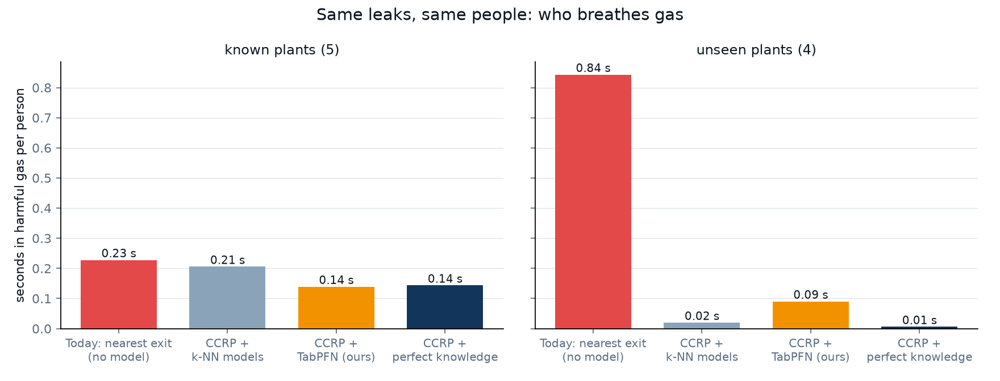

<p align="center"></p>

# Via Libera

**Find the leak. Forecast the hazard. Guide people to safer exits.**

Via Libera is a factory evacuation prototype built for the Berlin AIxRobotics Hackathon,
Prior Labs track. It uses gas detector readings to estimate a leak's location and height,
forecast the spread of gas, and plan evacuation routes as conditions change. The source and
hazard models use TabPFN with simulated examples generated for the plant; the route planner
uses those predictions to account for risk and exit capacity.

This is a research prototype. The results below are simulated comparisons and limited tests on
public gas datasets, not validation for use in an emergency.

## Try the demo

Requires Python 3.12+ and [uv](https://docs.astral.sh/uv/):

```bash
git clone https://github.com/stevensalloum/via-libera.git
cd via-libera
uv sync
uv run via-libera
```

The command opens the presentation and a saved 3D factory replay. It does not run inference or
spend TabPFN credits. The 3D viewer loads Three.js from a CDN, so it needs an internet
connection. Select **Enter the factory** to explore the replay, or run
`uv run via-libera --list` to see the available saved runs.

The presentation videos are supplied locally under `demo/media/`. See the
[presentation guide](docs/presentation.md) for controls and the shot list.

## Results

In a 3D simulation study, the team compared routes for the same people and leaks across nine
plants: five known layouts and four unseen layouts, with one leak per plant. The table compares
nearest-exit routing with the capacity-constrained planner using TabPFN predictions.

| Measure | Known plants: nearest / Via Libera | Unseen plants: nearest / Via Libera |
|---|---:|---:|
| Mean time in harmful gas per person | 0.23 / **0.14 s** | 0.84 / **0.09 s** |
| People exposed | 3.7 / **2.3%** | 6.2 / **2.4%** |
| Time until 95% have exited | 41 / 42 s | 43 / 40 s |



The [full results table](docs/results/final-table.md) includes the perfect-information and
k-NN comparisons and a further six unseen plants. These are small, simulated samples rather
than evidence of real-world evacuation performance. In the nine-plant study, toxic hazard
recall was 22% on known plants and 26% on unseen plants at the reported operating point;
improving detection of hazardous cells is an important next step.

The project also compares source estimation and hazard ranking on public gas datasets. The
[recorded results](docs/figures/final/real_data_comparison.json) include Red:Vapor, SRGDM,
Örebro and UCI; sample sizes are small and the Red:Vapor source comparison reports different
sample counts for the two methods. See the [figures](docs/figures/final/) for details.

## How it works

1. **Locate:** detector histories and wind readings produce a distribution over leak locations,
   along with estimates of release rate and height.
2. **Forecast:** the hazard model estimates where gas will be harmful at future times.
3. **Route:** evacuation planners use the forecast, plant geometry and exit capacity to compare
   routes; the simulation updates plans as new readings arrive.

The simulator, source and hazard estimators, and planners retain baseline implementations for
comparison. See [the project brief](docs/brief.md), [results](docs/results/final-table.md) and
the team's [development notes](docs/journey/).

## Run and reproduce

```bash
uv run pytest                             # test suite; no cloud calls
uv run ruff check .                       # lint
uv run ruff format --check .              # formatting
uv run world                              # interactive 3D factory
uv run evac-pipeline --models team --backend baseline  # offline 2D view
uv run sync-check                         # check interfaces between components
```

To reproduce the final study with cloud inference:

```bash
uv run evac-final --backend cloud --leaks 1 --unseen 1 --n-train 100
```

This is a paid cloud run, estimated at about 1 million tokens per plant and leak in the team's
measurements. The saved demo does not need a key; cloud runs require a `TABPFN_TOKEN` in a
local `.env` file copied from `.env.example`. Run `uv run tabpfn-check` to check the key and
obtain cost quotes. For the offline k-NN comparison, use `--backend baseline` instead of
`--backend cloud`. Local TabPFN is available with `uv sync --extra local` and requires model
downloads and appropriate hardware.

## Repository

The Python package is named `tabpfn_spatial`, the project's working name.

| Path | Contents |
|---|---|
| `src/tabpfn_spatial/sim/` | Factory layouts, gas simulation and scenarios |
| `src/tabpfn_spatial/source/` | Leak location, release rate and height estimation |
| `src/tabpfn_spatial/hazard/` | Gas and hazard forecasts |
| `src/tabpfn_spatial/evac/` | Evacuation planners and studies |
| `src/tabpfn_spatial/world/` | 3D viewer and presentation |
| `tests/` | Offline tests for the simulator and models |
| `docs/` | Methods, results, figures and team notes |

## Team

Built by [Steven](https://github.com/stevensalloum),
[Rayan](https://github.com/RayanElKhoury) and [Ahmad](https://github.com/Asorus).
The team used AI coding assistants during development; the code was reviewed, tested and
integrated by the team.
