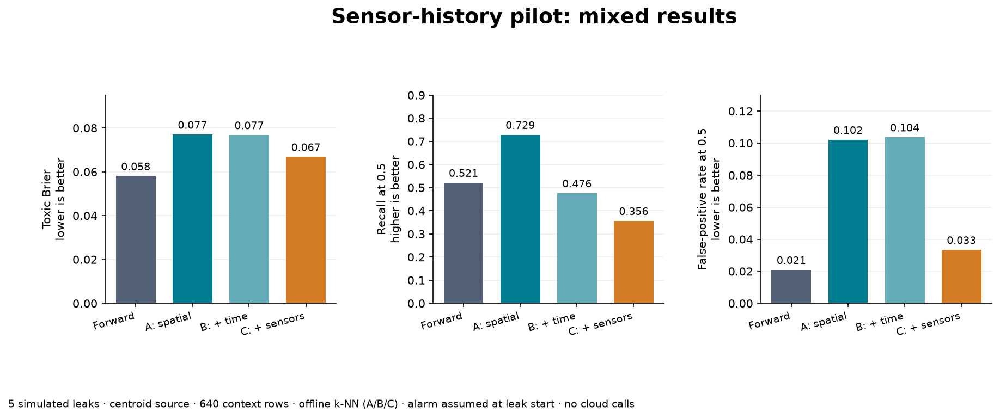
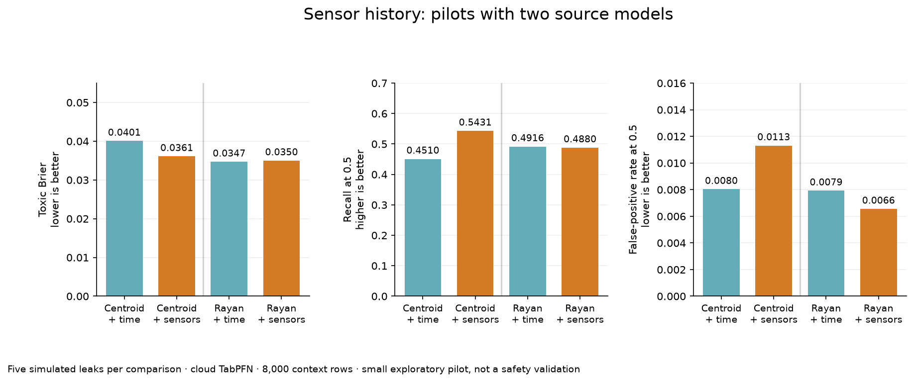
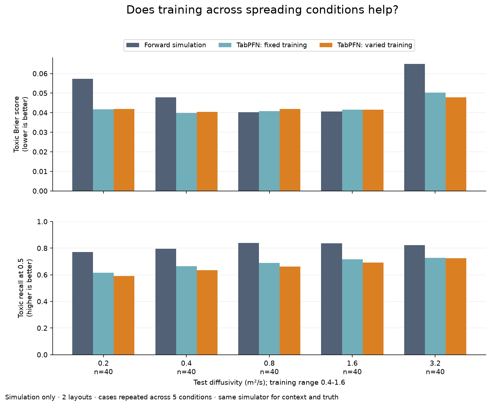
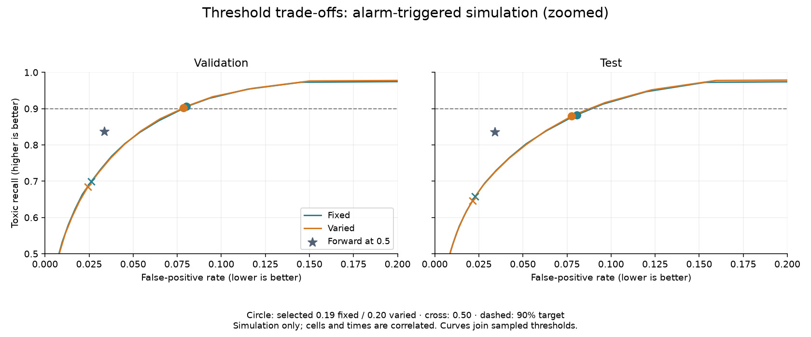
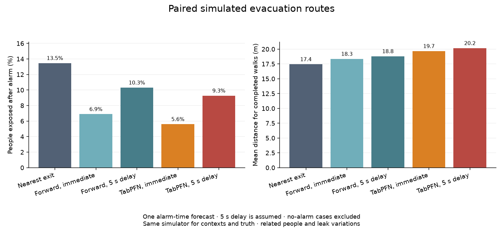
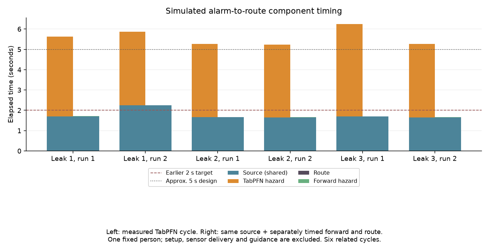
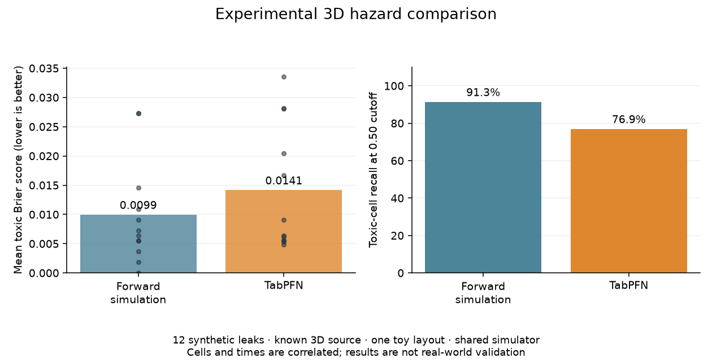

# Ahmad's hazard-prediction journey

## 2026-11-21: Optional sensor-history features

We tested whether gas readings add information beyond the source estimate,
measured wind and existing spatial features. The original seven-feature model
remains the default. Two optional configurations add observation/horizon time
alone, or time plus nearby sensor values, trends and availability flags. The
simulated event assumes the alarm coincides with leak start at T=0.



Recreate the figure without model calls:

```bash
uv run python tests/hazard/plot_sensor_history.py
```

The five-leak offline pilot used the default pipe factory, centroid source,
evaluation seed 0, 640 identical context rows seed 1001 and first-30-second
forecasts. Forward simulation vs offline k-NN spatial A / time B / sensor C:
toxic Brier 0.05806 / 0.07700 / 0.07679 / 0.06681; recall at a 0.5 threshold
0.52153 / 0.72847 / 0.47608 / 0.35646; false-positive rate 0.02092 / 0.10207 /
0.10366 / 0.03339. All used zero cloud credits. C improved Brier relative to A
but missed more hazardous cell/time observations at this threshold. None of the
four routes exposed a person in five cases; this is inconclusive. The sample is
too small to select a production configuration.

Exact settings, source assumptions, feature definitions and limitations are in
[`SENSOR_HISTORY.md`](../../src/tabpfn_spatial/hazard/SENSOR_HISTORY.md).

## 2026-11-21: Cloud pilots with centroid and Rayan source estimates

The cloud version compared B (time context) against C (the same inputs plus
sensor history), with the same generated examples and source estimate within
each comparison. Five simulated leaks, seed 0, and 8,000 hazard context rows,
seed 1001: centroid B vs C Brier 0.04006 vs 0.03609 and recall 0.45096 vs
0.54306; Rayan B vs C Brier 0.03468 vs 0.03499 and recall 0.49163 vs 0.48804.
Forward baselines were 0.05806 Brier and 0.52153 recall for centroid, and
0.02786 and 0.76435 for Rayan. Rayan B/C false-positive rates were 0.00792 vs
0.00655; centroid B/C 0.00803 vs 0.01131. This limited test does not support
enabling sensor inputs by default when using Rayan, and does not prove they are
redundant. The pilots used 150,000 and 190,000 quoted credits respectively.



Redraw without model calls:

```bash
uv run python tests/hazard/plot_sensor_history_cloud.py
```

Each pilot used one factory and the same simulator to make context and targets;
Rayan used a pipe prior in the first case. Route replay omitted latency. Full
settings, uncertainty and baselines are in
[`SENSOR_HISTORY.md`](../../src/tabpfn_spatial/hazard/SENSOR_HISTORY.md).

## 2026-11-22: Partial paired multi-layout validation

Compared the existing forward simulation, cloud TabPFN with centroid-sourced
context, and the same TabPFN with Rayan-sourced context, on the same source
outputs and ground truth. The requested time window ended before the four-layout
plan completed: 117 scenario variations from 28 base leaks in two layouts, with
unequal condition sizes. Standard-condition Brier was 0.02719 / 0.05825 /
0.03628 (28 cases); under changing wind it was 0.04107 / 0.05988 / 0.04080
(25). Other stress conditions and the recall, false-positive and route baselines
are in [`MULTIPLANT_RESULTS.md`](../../src/tabpfn_spatial/hazard/MULTIPLANT_RESULTS.md).
The Rayan-context model improved Brier relative to the centroid-context model in
all six partial groups; the forward baseline had higher threshold recall. These
results use simulated data only and do not establish a general winner.


Reproduce the figure from the recorded aggregates without model calls:

```bash
uv run python tests/hazard/summarise_multiplant.py \
  --recorded \
  --figure docs/figures/ahmad/03-multiplant-validation.png
```

At least 1,070,000 credits were quoted for completed cloud calls, including the
small pilot and batching checks; interrupted calls and actual provider billing
are unknown. Forward and unit-test baselines used zero cloud credits.

## 2026-11-22: Training with varied simulated spreading

Added an optional log-uniform diffusivity range for hazard context generation,
using the same value for each leak's readings and targets. The existing fixed
context remains the default. The hidden diffusivity is not a prediction input.
With two factory layouts and 20 held-out leaks per layout, each evaluated at
five diffusivities, varied training did not consistently beat fixed training:
at diffusivity 0.8, forward / fixed / varied Brier was 0.04030 / 0.04076 /
0.04183 and recall was 0.8388 / 0.6896 / 0.6617. At the held-out high
diffusivity 3.2, Brier was 0.06484 / 0.05020 / 0.04791 and recall 0.8230 /
0.7272 / 0.7232. At a 0.5 threshold, varied training's recall was lower than
fixed training's in all five conditions; its false-positive rate was also
lower. The complete comparison used 882,720 quoted cloud credits vs 0 for
forward, with 8,000 hazard context rows, hazard seed 1001, source seed 12345,
test seed 20261129, and preselected training range 0.4-1.6 m²/s.



Redraw the figure from recorded aggregates without cloud calls:

```bash
uv run python tests/hazard/summarise_diffusivity.py --recorded \
  --figure docs/figures/ahmad/04-diffusivity-study.png
```

The full comparison, bootstrap limitations and commands are in
[`DIFFUSIVITY_STUDY.md`](../../src/tabpfn_spatial/hazard/DIFFUSIVITY_STUDY.md).
The five test settings repeat each leak, context and truth use the same
simulator, and the layout is known when its context is generated. This is not
an independent physical or real-world validation.

## 2026-11-22: Alarm-triggered threshold and source-prior investigation

At fixed snapshot times, the earlier spread experiment produced 33 case
variations from 13 layout/leak pairs before any sensor alarm, so Rayan's
locator returned the pipe prior.
An exploratory continuation with new future sensor noise led to an alarm in
26/33 by 120 s and no alarm in 7/33. On the 26 updated source estimates, median
top-source error was 17.0 m from the prior vs 1.0 m from Rayan's cloud locator;
16 improved, two worsened, eight were the same. The 33 variations are
correlated; the continuation is simulated. Those source calls quoted 40,000
credits vs zero for the prior.

We then selected probability cutoffs on separate alarm-triggered validation
leaks to target 90% pooled toxic recall, froze them, and tested on independent
leaks. Each split had two known layouts, 20 base leaks per layout repeated
across five diffusivities; source/hazard/validation/test seeds were
12345/1001/20261201/20261202. Fixed context at 0.50 vs 0.19 had validation
recall 69.91% vs 90.55% and FPR 2.62% vs 8.02%; independent test recall
65.76% vs 88.27% and FPR 2.29% vs 8.05%. Varied context at 0.50 vs 0.20
had validation recall 68.51% vs 90.17% and FPR 2.44% vs 7.85%; test recall
64.65% vs 87.93% and FPR 2.14% vs 7.76%. The forward baseline was 83.71% /
83.52% recall and 3.37% / 3.39% FPR on validation / test, with zero credits.
Cloud threshold work and source diagnosis were quoted at about 1.8 million
credits including repeats; interrupted requests and actual billing are unknown.



Redraw from recorded aggregate counts without cloud calls:

```bash
uv run python tests/hazard/summarise_threshold.py --recorded \
  --figure docs/figures/ahmad/05-threshold-tradeoff.png
```

The held-out test did not reach 90% pooled recall, although its exploratory
bootstrap interval includes 90%. The noisy-reading sensor alarm did not trigger in
5/200 validation and 21/200 test variations by 120 s (one and five underlying
layout/leak pairs respectively); scores are conditional
on an alarm. Steven's clean-field simulation alarm and Rayan's noisy-reading
alarm can also disagree at the first call. The shared planner remains unchanged.
Full subgroup metrics, alarm definitions, assumptions and reproduction are in
[`THRESHOLD_STUDY.md`](../../src/tabpfn_spatial/hazard/THRESHOLD_STUDY.md).

## 2026-11-22: Warning overlays and evacuation routes

We replayed the same alarmed simulated leaks with nearest-exit, forward-simulation
and TabPFN-based routing, using the existing planner. Of 200 correlated case
variations across two layouts, 194 alarmed within 120 s. Each produced eight
matched person-variations; six non-alarming cases were excluded. Nearest exit,
immediate forward and immediate TabPFN exposed 209, 107 and 87 of 1,552
person-variations, respectively, with mean completed distances of 17.45,
18.35 and 19.66 m. With an assumed five-second forecast delay, forward and
TabPFN exposed 160 and 144; distances were 18.79 and 20.16 m. The delay was not
measured, and these are correlated simulations rather than independent workers.

Of 1,485 person-variations starting in a safe cell, immediate TabPFN exposed
20 and forward exposed 40. Nine were exposed only on the TabPFN route and 29
only on the forward route; gas movement also affects exposure. The exploratory
paired interval for TabPFN versus forward includes zero. This experiment does
not establish superiority over forward simulation or guarantee safe routes.

The 19% warning overlay and a 50% comparison were observed on the same TabPFN
walks: they flagged 144 vs 71 of 229 toxic one-second samples, missed 85 vs
158, and falsely flagged 149 vs 27 of 24,011 safe samples. The overlay did not
change the route. The study used one forecast, simulated individual movement,
and the same simulator family for context and truth; it did not test crowds,
later updates, real gas or the actual live response time.



Redraw this figure without cloud calls:

```bash
uv run python tests/hazard/summarise_routes.py --recorded \
  --figure docs/figures/ahmad/06-route-outcomes.png
```

The final cloud requests quoted 1,044,389 credits; a stopped pilot quoted at
least another 157,024 and an interrupted request may also be billed. Details,
matched counts, uncertainty and reproduction are in
[`ROUTE_STUDY.md`](../../src/tabpfn_spatial/hazard/ROUTE_STUDY.md).

## 2026-11-22: Alarm-to-route component timing

We measured the existing team components on three simulated leaks in the default
factory (seed 20261204), with two successive cloud cycles and one fixed person
per leak. The source locator ran in live mode; the hazard model used its default
8,000-row true-source context. The median source / TabPFN hazard / one-route
times were 1.676 / 3.623 / 0.003 s; the total median was 5.445 s, range
5.230–6.244 s. With the same source outputs, adding separately measured forward
hazard and route times gave a median 1.689 s, range 1.659–2.256 s. The forward
sum is an estimate assembled from separate timings.

The first source rate was the prior for all three leaks; the second cycle
received a completed earlier estimate. Source errors were 0/0, 0/0 and 4/0 m
on the first/second cycles, respectively. These six related observations cannot
establish general accuracy or latency. The fixed person did not move, and setup,
sensor delivery, guidance and crowd planning were excluded. The real live loop
then used a clean-field alarm but noisy source readings, whereas the probe used
the same noisy history for both.



Redraw the recorded graph without cloud calls:

```bash
uv run python tests/hazard/plot_integrated_timing.py \
  --figure docs/figures/ahmad/07-integrated-timing.png
```

The six cloud cycles quoted about 180,000 credits; actual billing or retries may
differ. Full methodology and reproduction are in
[`INTEGRATED_TIMING.md`](../../src/tabpfn_spatial/hazard/INTEGRATED_TIMING.md).

We also checked Steven's simulated live loop on one moving person and two cloud
cycles (same seed, default layout; about 60,000 quoted credits). The system and
noisy sensor alarms both fired at simulated 5 s. Two and three readings fed
the first and second decisions; source + hazard took 2.213 + 4.523 s and
1.694 + 4.213 s, with routes landing at simulated 12 and 18 s. The person had
moved before each replan; both selected exit 1. Planner calls at each landing
took 0.0265 and 0.0227 s in total, not counted in the loop's landing clock.
This single simulated case does not measure real sensor or guidance delivery.

## 2026-11-22: One sensor history for alarm and predictions

Following Ahmad's discussion with Steven, the event-driven loop, single-person
replay and crowd preparation now determine their alarm from the same noisy
sensor history passed to the source locator. The single-person replay also
keeps old readings fixed instead of drawing them again at each update. If no
reading triggers the alarm, the models are not called, and the crowd replay
does not initialize them; an explicitly supplied fixed alarm remains available
as a simulation override. These changes do not
alter the sensor threshold or the hazard-probability reporting overlay.

The regression test uses constructed readings to check early alarms, later
alarms and no alarm in each of the three flows. It uses offline stand-ins and
spends no cloud credits. Earlier results and figures retain their original
alarm rules and should not be presented as if rerun after this change.

An offline compatibility smoke test also runs Rayan's source interface and the
optional varied-spread hazard predictor on Steven's L, U, T and campus factory
templates. All four returned finite 2D maps with the expected shapes (eight
source-context leaks, two hazard-context leaks, one constructed alarmed reading
per plant; baseline k-NN and zero credits). It checks the connection between
components, not accuracy or 3D gas behaviour.
## 2026-11-22: First explicit 3D hazard volume

The earlier work tested the 2D predictor under different spreads; it did not add
a height axis. This prototype accepts explicit 3D source hypotheses and 3D wall
and machine geometry, creates transient synthetic 3D context rows and outputs
toxic/fire probability volumes `(time, z, y, x)`. It can extract an explicitly
chosen height as a 2D slice. No height is guessed for Rayan's current 2D source
map, and the prototype is not connected to the team pipeline or 3D planner.

On 12 held-out simulated leaks (seed 20261211) in one 24 × 16 × 4 m layout,
known true 3D source, wind and rate, 80 context leaks (seed 20261210), three
times and varied diffusivity, forward simulation / cloud TabPFN mean toxic
Brier was 0.00994 / 0.01414 and recall at 0.5 was 91.34% / 76.91%. Pooled
false-positive rate was 0.57% / 0.87%, respectively. Source positions and
geometry were shared between training and evaluation; the simulator family was
also shared. The 12 cloud calls quoted 120,000 credits; the forward baseline
used none. The prototype uses relative concentrations and excludes ventilation
and buoyancy, so these are not real-world hazard or route-safety results.
An additional cloud call after bounding query-feature batches reproduced the
first case's Brier and threshold counts (10,000 quoted credits).



Redraw without cloud calls:

```bash
uv run python tests/hazard/plot_volume3d.py --figure docs/figures/ahmad/08-hazard-3d.png
```

Inputs, assumptions and reproduction are in
[`VOLUME3D.md`](../../src/tabpfn_spatial/hazard/VOLUME3D.md).

### 2026-11-22: First shared 3D source-to-hazard smoke check

Connected the experimental hazard prototype to Steven's plant geometry and
simulated training concentrations, plus the source map and height quantiles from
Rayan's work. A mast detector triggered before the original mounted detectors;
the old horizontal locator returned its prior at that instant. Source PR #53
adds a locator trained on all 3D detectors. The hazard adapter combines the
separate position and height distributions assuming independence and reports
how much probability the model retains.

One held-out propane case, context seeds 100/111/222, eight training leaks per
model, alarm 5 s, forecast 10 s, top one source (43.38% mass): forward / cloud
toxic Brier 0.02070 / 0.00728; recall at 0.5 0.49% / 43.69%; hazard call
0.046 / 4.90 s. Hazard cloud calls quoted 20,000 credits; source calls additional.
The forward model has different physics and scaling, and one case cannot validate
accuracy. The cloud model missed over half of the toxic voxels and exceeded the
2 s budget before source and routing calls. No new presentation figure: one smoke
case is not representative. Reproduce and see limits in `hazard/VOLUME3D.md`.

### 2026-11-22: Submission review

Reworked the repository opening page to put the saved demo, the study conditions
and limitations, and the cloud costs where a reviewer can find them. The existing
exposure figure is `docs/figures/final/1-exposure.png`, generated by
`uv run evac-compare` from the saved study runs; no new figure or model result was
generated for this documentation step.

On main `a5d6699`, GitHub Actions passed; local checks found 385 passing tests and
3 skipped, with Ruff lint and formatting passing. The local suite included an
existing untracked test. No cloud calls were made. The saved story, factory page
and replay data returned HTTP 200, but the referenced hero video returned 404:
the presentation videos are not in the checkout. The repository was private at
the time of review, so submission access also needs checking.
Steven has the presentation videos locally and will push the assets needed by the UI.
