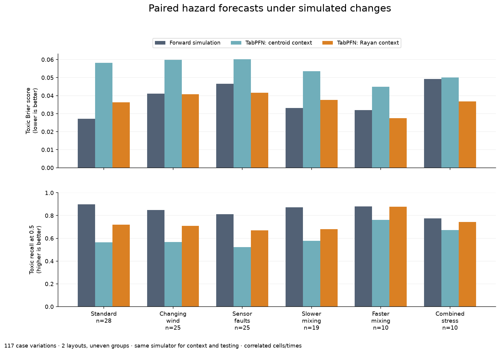

# Ahmad's hazard-prediction journey

## 2026-11-21: Optional sensor-history features

We tested whether gas readings add information beyond the source estimate,
measured wind and existing spatial features. The original seven-feature model
remains the default. Two optional configurations add observation/horizon time
alone, or time plus nearby sensor values, trends and availability flags. The
simulated event assumes the alarm coincides with leak start at T=0.


Recreate the figure without model calls:

```bash
uv run python tests/hazard/plot_sensor_history.py
```

The five-leak offline pilot used the default pipe factory, centroid source,
evaluation seed 0, 640 identical context rows seed 1001 and first-30-second
forecasts. Forward simulation vs offline k-NN spatial A / time B / sensor C:
toxic Brier 0.05806 / 0.07700 / 0.07679 / 0.06681; recall at a 0.5 threshold
0.52153 / 0.72847 / 0.47608 / 0.35646; false-positive rate 0.02092 / 0.10207 /
0.10366 / 0.03339. All used zero cloud credits. C improved Brier relative to A
but missed more hazardous cell/time observations at this threshold. None of the
four routes exposed a person in five cases; this is inconclusive. The sample is
too small to select a production configuration.

Exact settings, source assumptions, feature definitions and limitations are in
[`SENSOR_HISTORY.md`](../../src/tabpfn_spatial/hazard/SENSOR_HISTORY.md).

## 2026-11-21: Cloud pilots with centroid and Rayan source estimates

The cloud version compared B (time context) against C (the same inputs plus
sensor history), with the same generated examples and source estimate within
each comparison. Five simulated leaks, seed 0, and 8,000 hazard context rows,
seed 1001: centroid B vs C Brier 0.04006 vs 0.03609 and recall 0.45096 vs
0.54306; Rayan B vs C Brier 0.03468 vs 0.03499 and recall 0.49163 vs 0.48804.
Forward baselines were 0.05806 Brier and 0.52153 recall for centroid, and
0.02786 and 0.76435 for Rayan. Rayan B/C false-positive rates were 0.00792 vs
0.00655; centroid B/C 0.00803 vs 0.01131. This limited test does not support
enabling sensor inputs by default when using Rayan, and does not prove they are
redundant. The pilots used 150,000 and 190,000 quoted credits respectively.


Redraw without model calls:

```bash
uv run python tests/hazard/plot_sensor_history_cloud.py
```

Each pilot used one factory and the same simulator to make context and targets;
Rayan used a pipe prior in the first case. Route replay omitted latency. Full
settings, uncertainty and baselines are in
[`SENSOR_HISTORY.md`](../../src/tabpfn_spatial/hazard/SENSOR_HISTORY.md).

## 2026-11-22: Partial paired multi-layout validation

Compared the existing forward simulation, cloud TabPFN with centroid-sourced
context, and the same TabPFN with Rayan-sourced context, on the same source
outputs and ground truth. The requested time window ended before the four-layout
plan completed: 117 scenario variations from 28 base leaks in two layouts, with
unequal condition sizes. Standard-condition Brier was 0.02719 / 0.05825 /
0.03628 (28 cases); under changing wind it was 0.04107 / 0.05988 / 0.04080
(25). Other stress conditions and the recall, false-positive and route baselines
are in [`MULTIPLANT_RESULTS.md`](../../src/tabpfn_spatial/hazard/MULTIPLANT_RESULTS.md).
The Rayan-context model improved Brier relative to the centroid-context model in
all six partial groups; the forward baseline had higher threshold recall. These
results use simulated data only and do not establish a general winner.



Reproduce the figure from the recorded aggregates without model calls:

```bash
uv run python tests/hazard/summarise_multiplant.py \
  --recorded \
  --figure docs/figures/ahmad/03-multiplant-validation.png
```

At least 1,070,000 credits were quoted for completed cloud calls, including the
small pilot and batching checks; interrupted calls and actual provider billing
are unknown. Forward and unit-test baselines used zero cloud credits.
