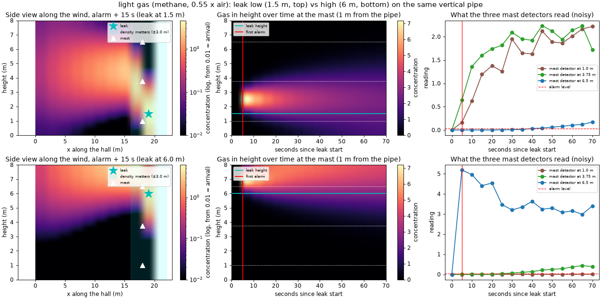
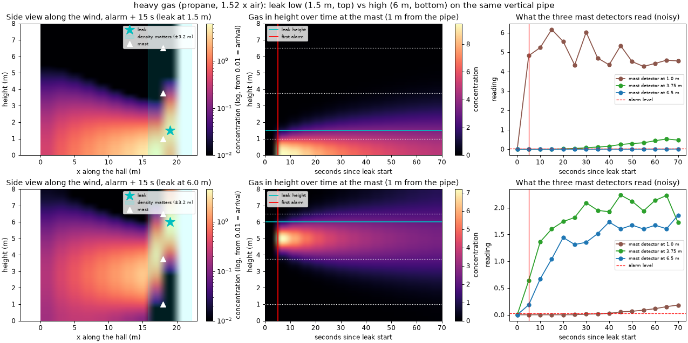
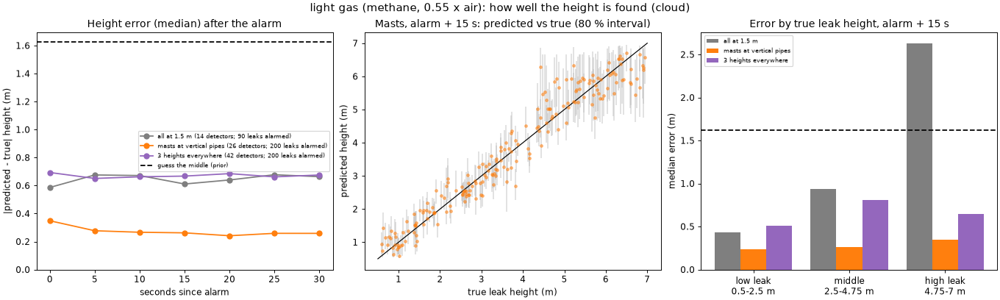
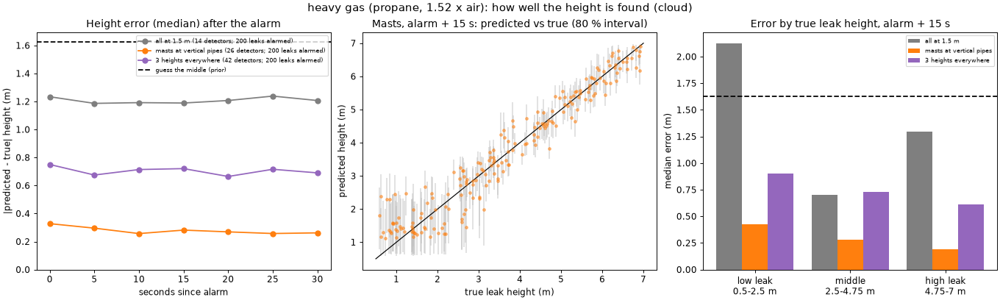
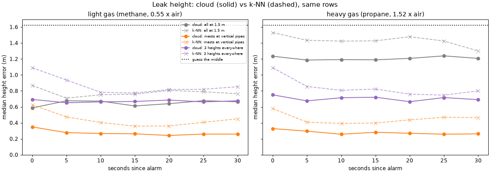
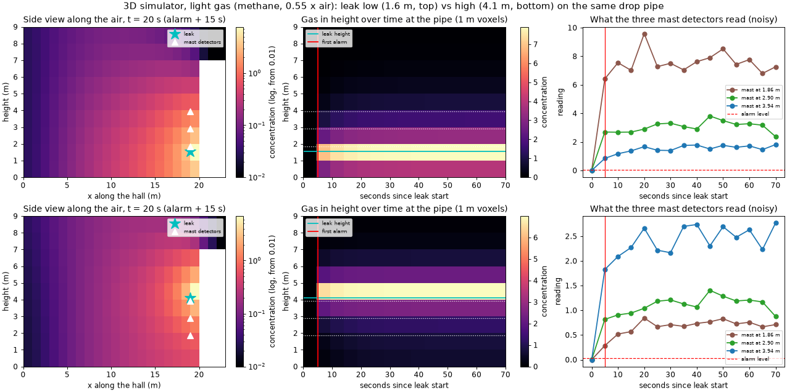
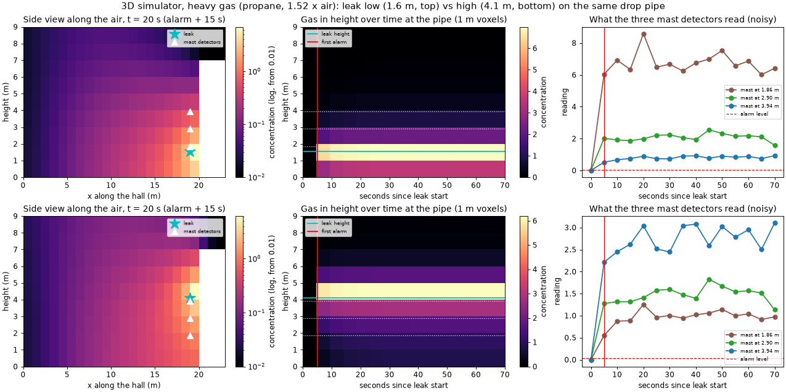
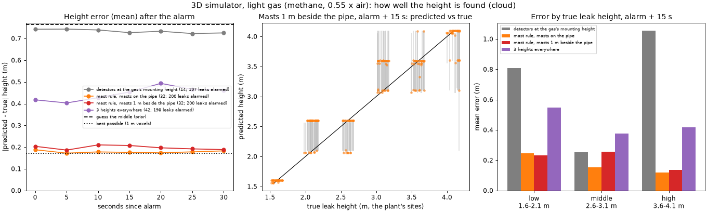
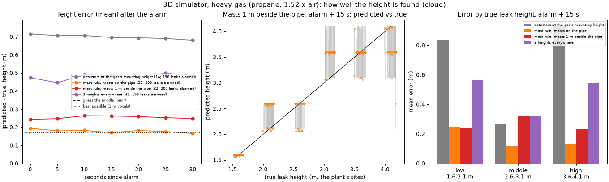
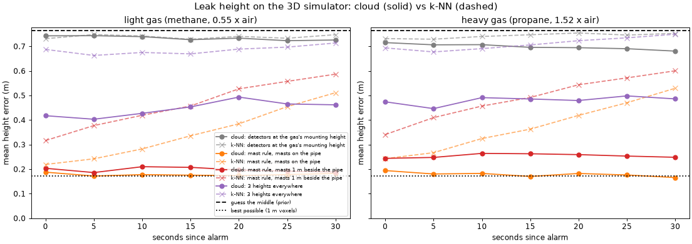

# Journey: Rayan (leak source detection)

One entry per step, newest at the bottom. Each figure is made by a command in the repo.
Earlier steps (the alarm-clock locator, leak size, live mode; PRs #25 and #33) are
summarised with their numbers in `docs/status/rayan.md`.

## 2026-11-22 · Leak height on vertical pipes: can the locator's row tell how high?

**What changed and why.** Pipes can run vertically (risers, drops to machine inlets), so a
leak's height is not known from its floor position. The robot and maintenance need it, and
the gas's density decides whether people should stay low or high near the leak. The
simulator is 2D (`sim.plume`: gas averaged over the hall's height), so before asking the
team to change it I checked whether height is learnable at all, with a stand-in in my own
folder (`source/vertical.py`): the 2D concentration at a detector times a height factor.

- **Height factor:** a bell curve in height around the leak height, reflected at floor and
  ceiling (no gas lost; its height average is exactly the 2D value, tested).
- **Width** grows with distance (10 % turbulence intensity, measured 9 % on Red:Vapor in
  Steven's 3D study) and with time (vertical mixing K).
- **Density:** light gas rises and heavy gas sinks, but only within the passive distance
  of `sim.gases` (Britter & McQuaid 1988); beyond it the gas follows the air.
- **Assumed, drawn per leak so no model can learn one exact rule:** K 0.005-0.05 m^2/s
  (log-uniform) and the rise/sink slope 0.5-1.5 m per m. Hall 8 m, leaks uniform at
  0.5-7 m on 4 vertical pipes spread over the default plant.
- **Detector layouts compared:** the plant's 14 detectors at 1.5 m (today); plus a mast of
  3 detectors (1.0 / 3.75 / 6.5 m) 1 m from each vertical pipe (26 detectors); every
  detector position at the three heights (42).
- **Model:** a height regressor on exactly the locator's row (per detector the latest
  reading and arrival time relative to the alarm, wind, seconds since alarm); 19 quantiles.
  The floor position is taken as known here (only the height is asked).

**Figures.** What the data look like, a low (1.5 m) and a high (6 m) leak on the same pipe:




How well the height is found (TabPFN cloud), and TabPFN against k-NN:





```bash
uv run python -m tabpfn_spatial.source.height_study --backend cloud   # or baseline: no API
```

**Numbers.** Median height error at alarm + 15 s; 600 training leaks (seed 100), 200 test
leaks (seed 200), default plant. Guessing the middle of the pipe: 1.6 m.

| Layout | Methane (light) TabPFN | k-NN | Propane (heavy) TabPFN | k-NN |
|---|---|---|---|---|
| All at 1.5 m (14) | 0.61 m (only 90/200 leaks alarm) | 0.76 m | 1.19 m | 1.43 m |
| **Masts at vertical pipes (26)** | **0.26 m** | 0.36 m | **0.28 m** | 0.40 m |
| 3 heights everywhere (42) | 0.67 m | 0.77 m | 0.72 m | 0.82 m |

- TabPFN with masts: 0.33-0.35 m already at the alarm (k-NN about 0.6 m); 80 % intervals
  hold the true height 71-85 % of the time.
- Being next to the pipe beats having many heights far away: masts win with fewer
  detectors than "3 heights everywhere".
- Light vs heavy with detectors only at 1.5 m: methane leaking high rises away and 110 of
  200 leaks never alarm (a safety gap, not only a height gap); propane always sinks past
  1.5 m, so it alarms but its height stays close to a guess. With masts both gases are
  found equally well.
- Backend `cloud` (TabPFN-3.5), 6 calls, 60,000 tokens (quoted 10,000 per call); results
  cached in `outputs/source_height/cache`, so the figures redraw for free. Latency 4-11 s
  per call of 630-1,400 test rows.

**What did not work.** The first side view used a pipe standing just upwind of a wall: the
plume had nowhere to go and the picture showed nothing. Now a pipe with 18 m of open floor
downwind and a log colour scale. A k-NN on raw rows needs 10-15 s after the alarm to settle;
TabPFN does not.

**Limits.** The two assumed ranges (K, slope) are not fitted to real data yet; machine heat,
3D ventilation, puffy plumes and detector response time are missing. The numbers will change
when the simulator itself gets heights (Steven is adding them); the study then reruns on
that data with the same command.

## 2026-11-22 · Leak height on Steven's 3D simulator (stand-in replaced)

**What changed and why.** Steven merged the 3D plant (`sim.plant3d`: heights of hall,
machines and pipes, vertical pipes, detectors by the mast rule) and time-stepped 3D gas with
buoyancy (`sim.gas3d`, #52). The height study now runs on it instead of my stand-in
(`source.vertical3d`, `source.height_study3d`; the stand-in study stays runnable).

- **Leaks:** the plant's own sites on its 6 vertical pipes (drops from the 4.2 m rack to the
  machine inlets, every 0.5 m: 1.56-4.1 m), drawn uniformly; size and air as in 2D.
- **Layouts**, all read from the same simulated gas: the 14 detectors at the gas's mounting
  height (4.0 m methane, 0.45 m propane); Steven's mast rule (+3 per vertical pipe, 32);
  the same masts 1 m beside the pipe (as built); every position at 0.45 / 1.6 / 4.0 m (42).
- **Table:** 600 training leaks (seed 100) x 7 moments (alarm + 0..30 s), 200 test leaks
  (seed 200); the locator's row; target = true height. One table per gas.

**Figures.**







```bash
uv run python -m tabpfn_spatial.source.height_study3d --backend cloud   # --quote: tokens only
```

**Numbers.** Mean height error (m) at the alarm / alarm + 15 s, 200 test leaks, default plant:

| Layout | Methane TabPFN | k-NN | Propane TabPFN | k-NN |
|---|---|---|---|---|
| Mounted only (14) | 0.74 / 0.73 | 0.73 / 0.73 | 0.72 / 0.70 | 0.73 / 0.75 |
| **Masts on the pipe (32)** | **0.19 / 0.18** | 0.22 / 0.34 | **0.19 / 0.17** | 0.24 / 0.36 |
| **Masts 1 m beside (32)** | **0.20 / 0.21** | 0.32 / 0.46 | **0.24 / 0.26** | 0.34 / 0.49 |
| 3 heights everywhere (42) | 0.42 / 0.45 | 0.69 / 0.67 | 0.47 / 0.49 | 0.69 / 0.71 |

Guess the middle: 0.76 m. Best possible with 1 m voxels: 0.17 m. 80 % intervals with masts
hold the true height 98-100 % of the time. Backend cloud, 8 calls, about 80,000 tokens
(predictions cached in `outputs/source_height3d/cache/default`).

- With masts TabPFN is at the voxel limit from the alarm on, for light and heavy gas; k-NN
  drifts to 0.35-0.5 m after the alarm. Masts 1 m beside the pipe cost only 0.02-0.07 m.
- Detectors at one mounting height do not tell the height (no better than a guess); 3 heights
  everywhere help a little; masts at the vertical pipes are what makes it work.
- Light vs heavy: nearly the same here; in the 3D gas the density matters only within about
  a metre of the leak, and the masts are that close.

**What did not work.** The first TabPFN run showed a *median* error of 0.00 m, below the
voxel limit. Cause: leaks at 2.1 and 2.6 m on one pipe start in the same 1 m voxel and give
identical gas (checked: difference 0.0). TabPFN picks one of the two and is either exactly
right or 0.5 m off; more than half the leaks land on "right", so the median hid the misses.
The 3D study reports the mean error. Also the first side view had a 7 m tank and a full-height
wall downwind; the figure now shows the drop at (19, 21) m with 19 m of open floor.

**Model for the merged project.** `source.HeightLocator` (fit on a `Plant3D`, readings from
`Run3D.readings`) fills `SourceEstimate.height` next to `TabPFNLocator`'s map and size.

**Limits.** One plant (a 7-plant version, `source.height_plants3d`, is written but not run:
time). 1 m voxels cap the accuracy at 0.17 m. Heights are from simulation only; real check:
Örebro3DSEN (sources at several heights, 27 sensors on 3 levels).
