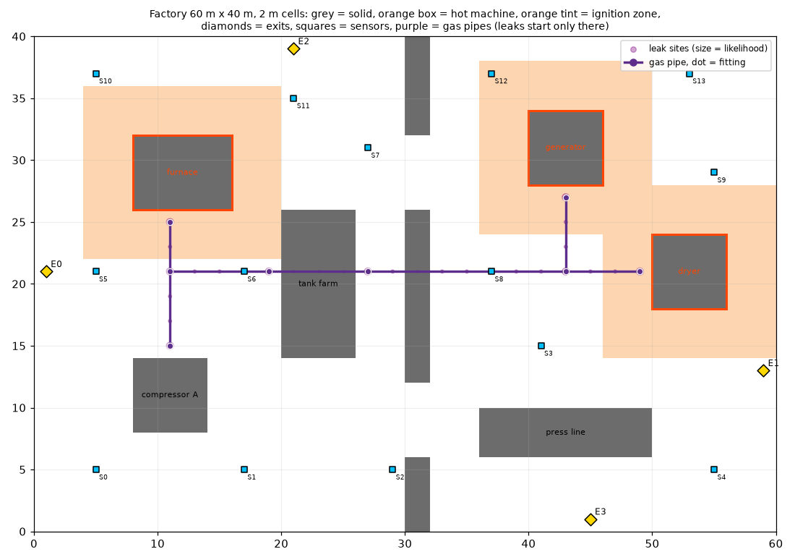
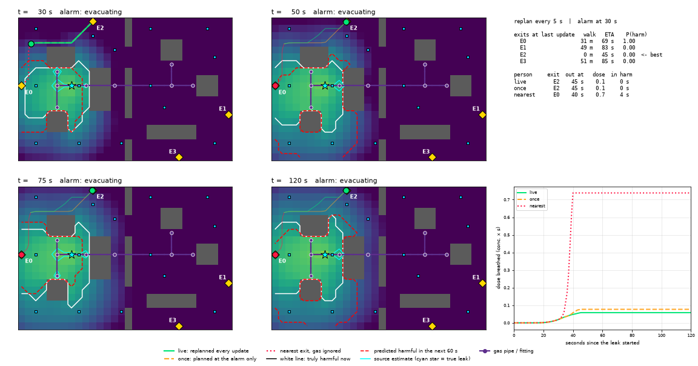
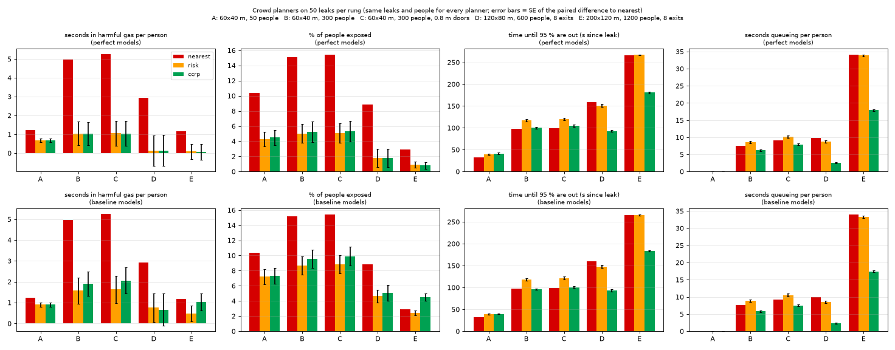
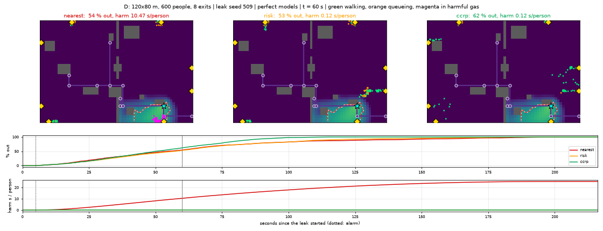
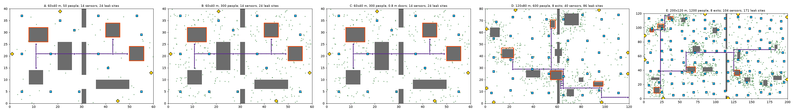

# Journey: Steven (factory, simulator, evacuation)

One entry per step, newest at the bottom. Each figure is made by a command in the repo.

## 2026-11-21 · Factory step 1: gas pipes, so leaks start where gas actually is

**What changed and why.** In v0, a leak could start on any open cell next to any machine
(110 sites, all equally likely), including machines that never carry gas, such as the press
line. Real releases come from the gas system, and mostly from its fittings (flanges, valves,
tees, machine connections), not from the middle of a straight pipe. The plant now has a pipe
network:

- **Default plant:** one gas main along y = 21 m runs from the tank farm west to compressor A
  and the furnace, and east through the partition wall to the generator and the dryer.
- **Leaks:** they start only on open pipe cells (24 sites). A fitting is 5 times likelier
  than a plain pipe cell (`FITTING_WEIGHT`). That number is an assumption to tune, not a
  measured value.
- **`Factory.leak_prior`:** the map of where a leak is likely before any reading. This is
  the prior Rayan's locator can start from.
- **`Factory.random`:** routes a pipe tree from a supply point on the outer wall to every hot
  machine plus one other machine. The routing prefers straight runs, with a penalty per
  bend, like real pipework.
- **`Factory.default(pipes=False)`:** the v0 plant, which reproduces the old numbers exactly.

Figure: `uv run sim-viz` (file `1_layout.png`), copied to `docs/figures/steven/01-pipes.png`.

**Numbers** (all-baseline pipeline, `evaluate(..., 30, seed=0)`):

| plant | source error | hazard Brier | exposed (plan / nearest exit) |
|---|---|---|---|
| v0, no pipes | 9.7 m | 0.091 | 5.7 / 7.2 of 30 |
| with pipes | 10.2 m | 0.076 | 5.6 / 7.2 of 30 |

The baseline locator ignores the prior, so its error barely moves. A locator that uses
`leak_prior` should gain the most: 24 candidate cells instead of 110.

**What did not work.** My first default network had two separate headers, one on each side
of the tank farm, so the pipe network was in two pieces (the test caught it). Real tank
farms have a manifold, so the main now runs through the tanks.

## 2026-11-21 · Evacuation step 1: one person, replanned live

**What changed and why.** The plan used to be computed once, at a fixed time. Now one person
is followed second by second:

- **Before the alarm:** the leak starts at t = 0 and the person stands still until the alarm
  (`--alarm`, default 30 s).
- **After the alarm:** every `--update` seconds (default 5) the system reads the sensors,
  asks the source and hazard models for new maps, and replans from where the person stands.
- **Three people from the same spot:**
  - **live:** replanned at every update;
  - **once:** planned at the alarm only;
  - **nearest:** nearest exit, gas ignored.

  All three are scored on the true gas: dose breathed, and seconds spent in toxic or
  flammable cells.
- **Stand-ins until the real models are linked:**
  - `OracleLocator`: the true leak plus an error of `--sigma` m (default 3), on the pipes;
  - `OracleHazard`: the true future, a perfect model and upper bound.

  The baselines can be used instead (`--source centroid`, `--hazard forward`), and any
  `SourceLocator` or `HazardPredictor` plugs in.
- **Planner fix:** routes no longer squeeze diagonally between two solid corners.

Figure: `uv run evac-live --seed 30 --t-max 120 --story docs/figures/steven/02-evac-live.png`.

**What the figure shows.** This is leak seed 30, on the compressor/furnace branch, with the
person starting at the top left. The nearest exit is E0, on the left, and the plume drifts
there. The nearest-exit person walks into it (dose 0.7, 4 s in harm). The gas-aware person
goes up to E2 instead (dose 0.1, 0 s in harm). In the live window (`uv run evac-live`) you
can click anywhere to move the person.

**Numbers** over 60 leaks, each with one random starting point
(`uv run evac-live --compare 60`):

| setting | live (exposed, harm-s, dose) | once | nearest exit | harm-s before alarm |
|---|---|---|---|---|
| default: source error 3 m, forward-sim hazard, drift 0.05, alarm 30 s | 9, 133, 0.73 | 9, 131, 0.71 | 11, 137, 0.78 | 98 |
| perfect hazard, drift 0.15 | 7, 106, 0.71 | 7, 106, 0.72 | 10, 138, 0.88 | 87 |
| baseline centroid source, drift 0.15 | 8, 126, 1.00 | 8, 132, 1.02 | 10, 138, 0.88 | 87 |
| default, drift 0.15, **alarm 15 s** | 5, 38, 0.22 | 5, 38, 0.22 | 5, 42, 0.29 | 27 |

What we learned (honest, small sample):

1. **Planning around the gas helps:** 7 to 9 people exposed out of 60, against 10 to 11 for
   the nearest exit.
2. **Replanning every 5 s changed nothing here.** In none of the 60 runs did the live person
   end at a different exit than the plan-once person. The hall is small, so a walk takes
   15 to 45 s, and the plume barely changes within one walk. Replanning should start to
   matter with longer walks, faster wind changes, crowds, or a model that gets much better
   as readings come in.
3. **Most harm happens before the alarm:** 98 of the 133 harm-seconds come while people are
   still waiting. Moving the alarm from 30 s to 15 s cuts harm-seconds from 133 to 38. **The
   first decision time matters far more than the update rate.** This is the input for the
   timing study (step 4) and for Rayan and Ahmad: a usable estimate early beats a perfect
   one late.
4. **A bad source estimate can do worse than ignoring the gas.** With the baseline centroid
   locator, the gas-aware people breathe more (dose 1.00) than the nearest-exit people
   (0.88). The planner is only as good as the maps it gets.

**What did not work.** The first version of the still figure drew one legend per panel, and
they overlapped. It now has one legend for the whole figure.

## 2026-11-21 · Timing study: when to decide, how often to replan, how fast to answer

**What changed and why.** We had to pick the decision time (`t_obs`), the update rate, and
how fast TabPFN must answer, without guessing. `uv run evac-timing` runs the live
one-person evacuation on the same 100 leaks (seeds 0-99) under every timing.

- **Two model settings bracket what TabPFN can reach:**
  - **baseline:** today's centroid locator plus forward-simulation hazard;
  - **perfect:** true leak plus true future.
- **New in the live loop:** `latency`, the seconds from readings to route. Until the first
  route arrives, people either walk to the nearest exit (`before_plan="nearest"`) or wait
  where they are (`"wait"`).

Figure: `uv run evac-timing --leaks 100 --workers 10` (3.5 min on 10 cores), copied from
`outputs/timing/timing.png`. Re-plot without rerunning: `--plot-only`.

**Numbers** (per person, mean of 100 leaks; harm-s = seconds in toxic or flammable gas):

| first decision `t_obs` | 10 s | 20 s | 30 s | 60 s | 120 s |
|---|---|---|---|---|---|
| harm-s before the alarm | 0.3 | 1.0 | 2.0 | 5.9 | 15.0 |
| % exposed, nearest exit | 6 | 14 | 17 | 22 | 25 |
| % exposed, live, baseline models | 6 | 11 | 15 | 18 | 21 |
| % exposed, live, perfect models | 6 | 9 | 13 | 17 | 20 |
| baseline source error (m) | 5.9 | 7.4 | 8.6 | 9.7 | 10.4 |
| baseline hazard Brier | 0.078 | 0.084 | 0.094 | 0.103 | 0.115 |

| model latency (alarm 30 s, perfect models) | 0 s | 2 s | 5 s | 10 s | 20 s |
|---|---|---|---|---|---|
| harm-s, walk to the nearest exit meanwhile | 2.31 | 2.53 | 2.65 | 2.81 | 2.84 |
| harm-s, wait for the route | 2.31 | 2.57 | 3.00 | 3.70 | 5.04 |
| harm-s, nearest exit without any model | 2.84 | 2.84 | 2.84 | 2.84 | 2.84 |

Seconds between replans (2 to 60 s) changed nothing: 2.92-2.96 harm-s with the baseline
models, 2.23-2.24 with the perfect ones.

What we learned (2D simple physics, one person per leak, 60 x 40 m hall):

1. **Decide early.** Every extra 10 s of waiting costs about 1 to 1.5 harm-seconds per
   person, almost all of it while people are still standing still. Exposed people go from
   6 % at 10 s to 22 % at 60 s. No better estimate can buy that back: even perfect models
   at 60 s (17 %) do worse than the nearest-exit plan at 20 s (14 %).
2. **The baseline locator gets worse with time** (5.9 m at 10 s, 10.4 m at 120 s): the
   reading-weighted centroid drifts downwind as the plume spreads. A model that reads the
   time series should improve instead. **Rayan's locator is built for 60 s** (readings at
   20, 40 and 60 s). We need versions that answer at 20 to 30 s.
3. **Routing helps, and better models help more.** After the alarm (at 30 s), routing
   controls 0.88 harm-s per person with the nearest exit, 0.82 with baseline models and
   0.35 with perfect models. That gap is the room for TabPFN.
4. **Replanning rate does not matter here.** Walks are short (15-45 s) and the plume
   changes slowly, so one route at the alarm is enough. Replanning every 10-30 s keeps
   TabPFN calls (and tokens) low. It may matter later with crowds and longer routes.
5. **Answer fast, and never make people wait.** With people walking to the nearest exit
   meanwhile, a route that arrives after 2 s keeps about 60 % of the gain, after 5 s about
   35 %, after 10 s almost nothing. Waiting for the route is worse than the plain
   nearest-exit plan as soon as the model takes more than about 4 s. So the alarm should
   send people to the nearest exit at once, and a guide robot should redirect them when the
   route lands. This sets the target for step 5 (cache, fast model, local inference):
   **a route within about 2 s of the readings.**

**What did not work.** The exact source stand-in showed 0.32 m error: its blur was one cell
wide, so a neighbouring fitting (5 times likelier) sometimes outranked the true cell. The
blur is now half a cell, with a test over every leak site. In the first figure, the harm
the planner controls was hidden under the pre-alarm area, so it now has its own panel.
Caveats: the alarm here sounds at a fixed time. A real detector fires when gas reaches it,
which is the next thing to model.

## 2026-11-21 · Detector alarm and the sync check

**What changed and why.** The team agreed that the whole plant evacuates as soon as a
leak is detected. The default is the nearest exit, and a route replaces it when the models
say that exit is unsafe.

- **Detector alarm:** the alarm is now the first sensor sample (every 5 s, as Rayan said
  our sensors read) above `sim.ALARM_LEVEL` = 10 % of LEL. `run_live(t_alarm=None)` and
  `evac-live` use it by default. A fixed `t_alarm` still works for the timing study.
- **`uv run sync-check`:** runs the closed loop with any locator and predictor and checks
  every hand-over: shapes, the (iy, ix) grid, absolute times, probabilities, solid cells,
  ignition zones and routes. It also times each call. The teammates run it on their model
  before pushing.
- **`docs/sync.md`:** writes down the shared conventions, plus a heads-up list from
  reading their branches.

Figure: `uv run sync-check --timeline docs/figures/steven/04-sync-timeline.png`.

**Numbers:**
- **Alarm time** (default plant, 200 leaks, 14 sensors):
  - median 10 s, 90 % within 15 s, max 25 s with sensors read every 5 s;
  - median 6 s with every 1 s;
  - median 10 s with every 10 s.
- **Readings at the alarm:** 2 to 6 per sensor (median 3).
- **Walk to the nearest exit, no crowd:**
  - default plant: median 12 s, max 24 s;
  - random 200 x 100 m plant: median 39 s, 95th percentile 69 s, max 81 s.
- **Baselines through the sync check:** 0 problems at decision times 10/20/30/60 s on
  the default and a random plant. Warnings: the centroid map puts only 14-25 % of its
  mass on the pipes, and it gives no release rate.

What we learned:

1. **The models must answer at about 10 s, from about 3 readings.** Rayan's locator reads
   20/40/60 s and Ahmad's hazard is trained on 70-180 s: both are tuned for a moment when,
   on our plant, everyone is already outside.
2. **"Seconds since the leak started" is a simulation luxury.** A real plant only knows
   when the alarm went off, so features should be relative to the alarm.
3. **Large plants change the picture.** Walks of minutes make long forecasts and
   replanning matter, and crowds at the doors make the "fastest path" the wrong goal.
   `docs/research/evacuation.md` proposes capacity-constrained routing (CCRP with a risk
   cost) plus a cell-queue crowd model to score it.

**What did not work.** I test-merged the teammates' current branches locally. Rayan's
tests pick leak sites by fixed index and fail with 24 pipe sites; they all pass on
`Factory.default(pipes=False)`. This is a heads-up for their next push, not a merge
blocker: their branches are still in progress.

## 2026-11-21 · Crowds: who goes to which exit when everyone leaves at once

**What changed and why.** Until now one person was evacuated at a time, as if they were
alone in the hall. Real evacuations are crowds: an exit door passes about 1.3 people per
second per metre of width, and on big sites people walk for minutes. New pieces:

- **`evac.crowd`: a crowd simulator.** People move cell to cell.
  - Walking slows with density (Weidmann's speed-density curve).
  - Each cell and each exit door passes at most 1.3 people per metre of width per second.
  - A cell holds at most 90 % of jam density.
  - Queues are first come, first served.
  - Each person's dose, seconds in harm and seconds queueing are counted on the true gas.
- **`evac.fields`: exit fields.** One reverse search per exit gives every cell its cost
  and path to that exit (length + risk x danger). Planning costs the same for 50 or
  5,000 people.
- **Three crowd planners** (`evac.crowd_plan`):
  - **nearest:** the conventional plan;
  - **risk:** today's risk-aware routing, each person on their own;
  - **ccrp:** capacity-aware risk routing in the spirit of CCRP (Lu, George & Shekhar
    2005). People book exit doors earliest-arrival first, so queues are part of the cost.
- **Scenario ladder** (`uv run evac-crowd`), from simple to hard:

  | Rung | Plant | People | Exits | Doors |
  |---|---|---|---|---|
  | A | 60x40 m | 50 | 4 | 1 m |
  | B | 60x40 m | 300 | 4 | 1 m |
  | C | 60x40 m | 300 | 4 | 0.8 m |
  | D | random 120x80 m (40 sensors) | 600 | 8 | 1 m |
  | E | random 200x120 m (104 sensors) | 1,200 | 8 | 1 m |

  Workers stand mostly near machines. The detector alarm starts everything, and plans are
  redone every 15-20 s. Every planner sees the same leak, alarm, maps and people.
- **Watch it:** `uv run evac-crowd-live --rung D --seed 509` (window, `--gif`, `--still`).
- **Bigger random plants:** `Factory.random` now takes `exits_per_side` and
  `sensor_spacing`.

Figure: `uv run evac-crowd --leaks 50 --first-seed 500 --workers 10` (held-out leak seeds
500-549, about 5 min on 10 cores), copied from `outputs/crowd/ladder.png`.

Figure: `uv run evac-crowd-live --rung D --seed 509 --still docs/figures/steven/06-crowd-run.png --at 60`.
On this leak the nearest-exit crowd queues at the bottom exit, inside the gas (magenta).

| Plan | People exposed | Harm-s per person | 95 % out after |
|---|---|---|---|
| Nearest exit | 30 % | 25 | 166 s |
| Risk only | 1.8 % | 0.1 | 146 s |
| Capacity-aware (ccrp) | 1.8 % | 0.1 | 94 s |

**Numbers** (50 held-out leaks per rung; harm-s = seconds in toxic or flammable gas per
person; 95 % out = seconds since the leak):

| Rung | Models | Nearest: harm-s / exposed / 95 % out | Risk only | Capacity-aware |
|---|---|---|---|---|
| A, 50 people | perfect | 1.24 / 10.4 % / 32 s | 0.68 / 4.3 % / 40 s | 0.69 / 4.5 % / 41 s |
| B, 300 people | perfect | 4.97 / 15.1 % / 97 s | 1.04 / 5.0 % / 117 s | 1.03 / 5.2 % / 100 s |
| D, 120x80 m, 600 | perfect | 2.94 / 8.8 % / 160 s | 0.13 / 1.8 % / 151 s | 0.14 / 1.8 % / **93 s** |
| E, 200x120 m, 1,200 | perfect | 1.17 / 2.9 % / 266 s | 0.08 / 0.9 % / 267 s | 0.07 / 0.8 % / **181 s** |
| B, 300 people | baseline | 4.97 / 15.1 % / 97 s | 1.58 / 8.7 % / 119 s | 1.90 / 9.5 % / 96 s |
| D, 120x80 m, 600 | baseline | 2.94 / 8.8 % / 160 s | 0.76 / 4.6 % / 148 s | 0.66 / 5.1 % / 93 s |
| E, 200x120 m, 1,200 | baseline | 1.17 / 2.9 % / 266 s | 0.48 / 2.4 % / 266 s | 1.03 / 4.5 % / 184 s |

Narrow 0.8 m doors (C) look like B with about 5 % more harm and up to 20 % more queueing.

What we learned:

1. **Gas-aware routing is the big win.** With good maps it cuts seconds in gas by 45 %
   (50 people) to 95 % (big plants) against the nearest exit.
2. **Capacity awareness is what makes big plants fast.** With good maps it is as safe as
   risk-only routing and gets 95 % out 38 % sooner on D (93 vs 151 s) and 32 % sooner on
   E (181 vs 267 s), with about half the queueing or less. Risk-only routing piles everyone
   onto the safe exits: no faster than the nearest exit on big plants, slowest on our hall.
3. **With today's baseline maps, there is no free lunch.** Capacity-aware routing sends
   some people on longer walks, and longer walks cross gas that a wrong map missed. On the
   biggest plant it exposed more people than the nearest exit (4.5 % vs 2.9 %), though with
   less harm per person. Risk-only routing is the safest there but the slowest.
   **The planner's choice depends on how good the hazard map is.** A calibrated
   probabilistic map (TabPFN) is what turns capacity-aware routing into a pure win.
4. **About 1 leak in 50 never trips a detector** at 10 % LEL, on our hall and on the big
   plants alike (sensors every 15 m), so nobody is told to move. Sensor placement and
   coverage need their own study (step 3).

**What did not work.**
- **Plain CCRP with bad maps.** On the tuning seeds 0-49 with baseline maps, it exposed
  10.8 % of people on the biggest plant against 2.9 % for the nearest exit: it sent them
  on long detours through gas the map missed. I tried two fixes on seeds 0-19:
  - only divert when the queue saving is big: helped a little;
  - count extra walking double: helped a lot and kept the perfect-map results.

  The second is now the default (`DETOUR_WEIGHT = 2`). It was chosen on seeds 0-19 and the
  table above uses untouched seeds 500-549. On those seeds, plain CCRP still gives
  2.69 harm-s and 10.8 % exposed on E with baseline maps
  (`uv run evac-crowd --detour 1 --rungs B D E`).
- **My first exit-queue metric** saturated at the cell capacity and said nothing. It is
  replaced by seconds queueing per person.
- **A door-flow bug:** the first crowd simulator let 1.0 person/s through a 1.3 person/s
  door, because I capped the flow budget the wrong way. The door test caught it.

## 2026-11-21 · Taking Ahmad's measured latency as the design point

**What changed and why.** The timing study (simulated delays) asked for a route within about
2 s of the readings. Ahmad measured the real thing on 30 early-alarm pipe leaks (PR #24):
- **Cloud TabPFN:** source + hazard + one route takes a median of 3.9 s, 4.9 s at p95;
- **fast model:** about 2.7 s for the hazard call alone;
- **forward-simulation baseline:** 0.01 s.

So 2 s is not reachable in the cloud, and the design point is now about 5 s. His replay
also showed what to do about it: staged routes. At the alarm everyone heads for the
nearest exit; the baseline route lands almost instantly; the TabPFN route replaces it when
it arrives. That exposed 1/30 people, against 2/30 for TabPFN alone, 4/30 for the forward
baseline alone and 4/30 for the nearest exit (mean harmful seconds 0.33 / 0.47 / 1.17 /
0.87). In our timing study a 5 s delay still kept about 35 % of the routing gain with people
walking meanwhile, and the baseline stage recovers part of the rest.

`docs/sync.md` now carries these numbers. I test-merged his branch on top of #23-#29:
- no conflicts, all tests and lint pass;
- `uv run sync-check --hazard tabpfn_spatial.hazard:TabPFNHazardPredictor`: 0 problems on
  both plants at 10/20/30/60 s. The offline k-NN backend takes ~4.5 s per call; that time
  is not a cloud measurement.

**Next:** the live and crowd loops get the staged policy (baseline route, then the TabPFN
route after a measured latency), and the crowd ladder is rerun with a 5 s latency.

## 2026-11-21 · A 3D factory you can walk through

**What changed and why.** The 2D plots prove the models work. Pitching them needs a world
people recognise as a factory: other teams show realistic plants. `uv run world` exports
the plant and opens a Three.js viewer at http://127.0.0.1:8770.

- **Same obstacles as the model.** Every solid thing in 3D comes from the planner's
  `Factory`:
  - machine footprints are exact, and their 3D models stay inside them;
  - the inner wall is the solid non-machine cells;
  - the outer walls open only at the exits;
  - walking mode collides with the same solid grid the evacuation planner uses.

  The "Planner grid" layer draws the solid cells on top, so anyone can check that 3D
  equals the model.
- **What is drawn:**
  - a concrete floor with slab joints, yellow walkway lines and hatched ignition zones;
  - clad walls on a concrete plinth, with green exit doors and lit EXIT signs;
  - steel portal frames with high-bay lamps;
  - machines modelled by kind: tanks with domes and a catwalk, a brick furnace with a
    glowing door and chimney, blue compressor vessels, press frames over a conveyor, a
    genset with exhaust stacks, a rotary dryer drum;
  - yellow overhead gas pipes (the usual colour for gas lines) with valves at every
    fitting and drops into the machines they feed;
  - gas sensors on poles, labels and a clickable minimap.
- **Moving around:** orbit, fly-to presets (overview, top, inside, any machine or exit),
  and "Walk inside" at eye height (`WASD`, `Shift` to run).
- **Plants:** the default plant, or a random 120 x 80 m one with `uv run world --plant random`.

**Next:** put the simulation in the world, in three steps on one timeline.
1. People at their workstations; the leak; sensors lighting up as gas arrives.
2. The models at the alarm: source map, and hazard now, at t+30 s and t+60 s (Ahmad's
   horizons) as coloured volumes.
3. Routes and the crowd moving, with commands to close the doors of rooms that will be in
   danger.

**What did not work.**
- The first catwalk railings were drawn as solid yellow panels; they are now posts and
  rails.
- The planner-grid overlay was hidden under the machines; it is now drawn on top.
- Labels showed through walls at eye level; near the floor only labels within 22 m are
  shown.
