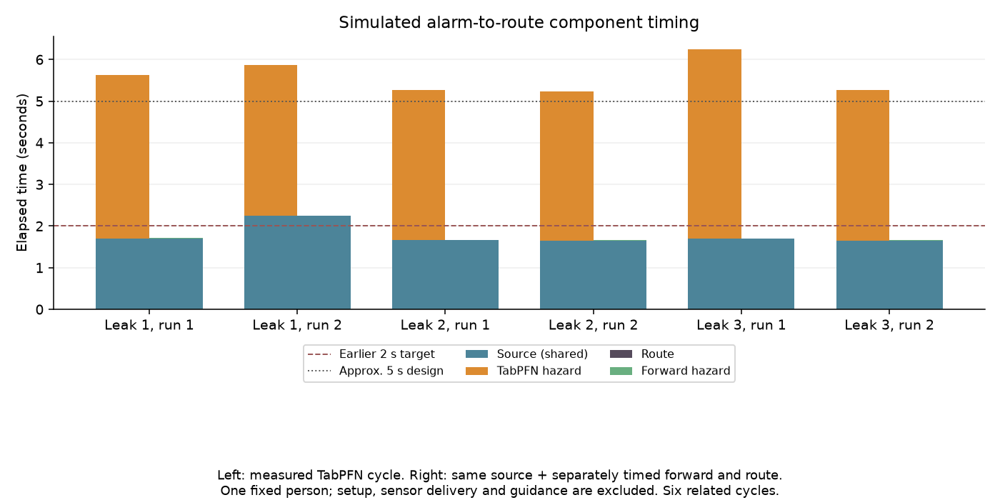

# Alarm-to-route timing probe

This small experiment measures the existing team components, without modifying
the source, simulator or evacuation code. It uses the same team-model setup as
`evac.pipeline_view.models_for`: Rayan's `TabPFNLocator(live=True)`, Ahmad's
`TabPFNHazardPredictor` and Steven's `RiskAwarePlanner`. The models are fitted
before timing starts. The default hazard setup here uses training rows based on
true simulated sources; this is different from the estimated-source context
used in `ROUTE_STUDY.md` and is not an accuracy comparison of those contexts.

On the default factory, three independently generated base leaks (seed
20261204, different from the context and earlier evaluation seeds) each have
one fixed simulated person's start. A single noisy sensor history defines both
the first alarm and the subsequent source readings. Two sequential cycles are
measured per leak, unless no alarm occurs. Each uses all readings available at
that simulated decision time. The next decision is placed at the next one-second
simulation step after the previous measured source + hazard + one route call;
sensor sampling remains every five seconds. It is not a fixed update interval.

The first cycle's release rate comes from the source locator's prior while its
rate model runs in the background. A subsequent call uses a completed previous
rate estimate if available; the exact timing of asynchronous work varies.
No model update is guaranteed to improve source accuracy. We additionally time
one forward-simulation hazard and route using the same source estimate; source
time plus these separate calls is an estimate, not an observed single pipeline
execution. The forward calculation runs after the TabPFN timing, not in parallel.

## Results

Cloud TabPFN, 8,000 hazard-context rows, 1,200 source-context leaks, 13 forecast
times to 120 s, top three source cells, the full 600-cell grid, and one planned
route per cycle. The source and hazard model versions are not pinned. Six cycles
from three leaks are related observations, too few for reliable tail latency.

| Component | Median | Range |
| --- | ---: | ---: |
| Source map in live mode | 1.676 s | 1.646–2.240 s |
| TabPFN hazard | 3.623 s | 3.576–4.550 s |
| One TabPFN-based route | 0.003 s | 0.001–0.005 s |
| Measured source + TabPFN hazard + route | 5.445 s | 5.230–6.244 s |
| Forward hazard, separately timed | 0.0117 s | 0.0086–0.0124 s |
| Same source + separate forward hazard + route | 1.689 s | 1.659–2.256 s |

All six measured TabPFN cycles exceeded both the earlier 2 s timing target and
the approximate 5 s design figure in `docs/sync.md`; neither is a validated
safety limit. These results do not establish a deployment latency distribution.
The times exclude model setup, alarm detection and sensor delivery, guidance
delivery, crowd planning, position tracking, and `run_pipeline`'s extra exit
options and other policy routes. The person remains in the same start position
for both measurements, and planning uses the decision-time position and clock;
there is no moving-person replay or exposure measurement. Thus the measured
total is a component path, not actual alarm-to-guidance latency in a real plant.

The initial source errors on the three leaks were 0, 0 and 4 m; on the second
cycle they were 0, 0 and 0 m. The locator used 2/3, 3/4 and 2/3 readings per
sensor across the first/second cycles, respectively. TabPFN selected the same
exit on both cycles for two leaks, and a different exit on the third; this is
not proof that the later route is safer. All three first-cycle rate medians
were the prior 1.0, and second-cycle medians were approximately 1.008, 0.672
and 0.969; the true simulated rates were approximately 0.670, 0.802 and 1.584.



At the time of these measurements, the live simulator detected its system alarm
using clean simulated fields and gave the locator a noisy history, which could
disagree. The alarm has since been aligned to that same noisy history in the
live and crowd simulations. The loop's model timer still excludes route computation.

## Simulated live-loop check

We also ran `evac.live.run_pipeline` itself for one additional generated leak
(seed 20261204, default factory, one moving person, cloud team models), with
two prediction cycles. This is an event-driven simulation, not a deployed
system, run before the alarm alignment. The clean-field system alarm and noisy
source alarm both fired at 5 s in this particular case. The first cycle started at 5 s with two readings
per sensor; source / hazard wall times were 2.213 / 4.523 s and the loop placed
its route at simulated 12 s. The second started at 12 s with three readings;
source / hazard wall times were 1.694 / 4.213 s and its route landed at 18 s.
The person moved in between, and both replans selected exit 1. Later guidance
did not establish a safer path: this single example measures flow, not safety.
The first rate median was the prior 1.0 and the second was 1.576, against a true
simulated rate of 1.652. The source error was 0 m on both calls. The person
reached the exit at simulated 27.96 s.

At the first and second route landings, all planner calls made by the loop
(including exit options and its comparison policies) took approximately 0.0265
and 0.0227 s in total, respectively; this excludes other orchestration costs.
The loop's own landing clock rounds the model-call times up to whole seconds and
does not add these planner times, sensor delivery, or guidance delivery. One
factory, one person and one run cannot establish crowd or operational latency.
The two extra cloud cycles were quoted at approximately 60,000 credits.

## Reproduce

Use a fresh output path. The baseline backend is the offline k-NN stand-in,
not local TabPFN. The cloud run costs credits; six cycles were quoted at about
180,000 in total (three model calls per cycle, approximately 10,000 each).
Provider billing or retries may differ.

```bash
uv run python tests/hazard/integrated_timing.py --backend cloud --run-cloud \
  --count 3 --output outputs/new-integrated-timing.jsonl
uv run python tests/hazard/plot_integrated_timing.py \
  --figure docs/figures/ahmad/07-integrated-timing.png
uv run python tests/hazard/live_loop_probe.py --backend cloud --run-cloud \
  --output outputs/new-live-loop.json
```

The second command redraws this report's recorded measurements, not the new
run. Detailed per-cycle outputs stay in the ignored `outputs/` directory.
