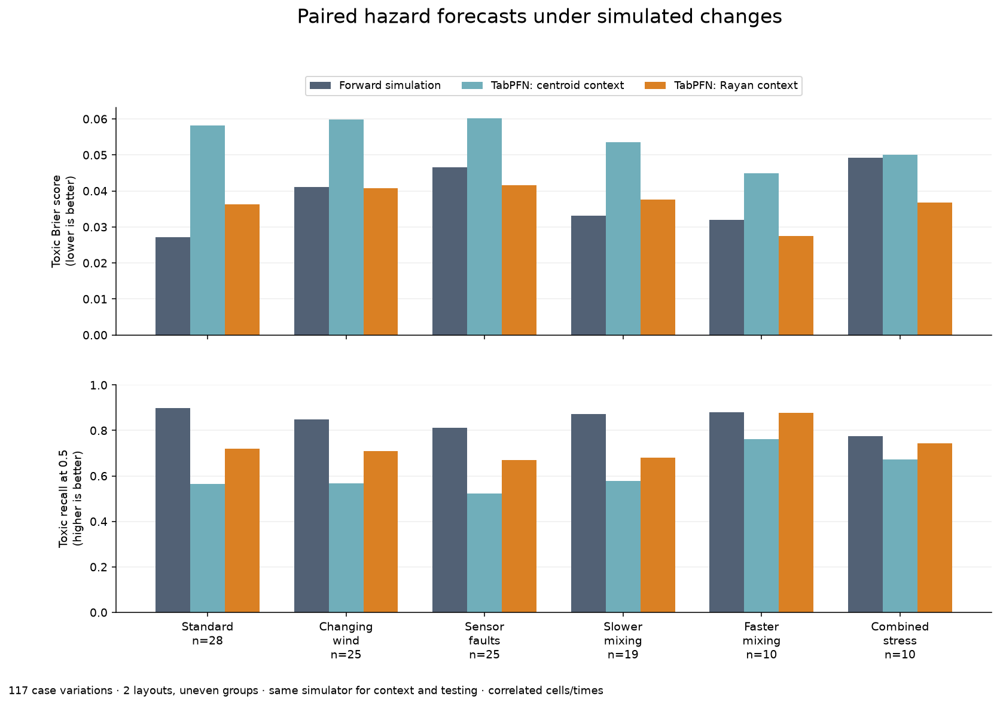

# Hazard comparison across simulated layouts and stresses

## Status and key result

Exploratory, partial study on merged main `e21aaa8`, stopped after the requested
30-minute window. The raw output contains **117 paired case variations from 28
base leak/seed combinations across two layouts**: the default hall (78 case
variations) and random layout seed 7 (39). The initially planned four-layout,
360-case run did not finish; groups are unequal and the last two conditions have
only the default layout. Each condition changes one or more settings for the same
underlying leak, so the 117 cases are not 117 independent leaks.

All three hazard methods used the same Rayan TabPFN source estimate per case:

- **Forward**: simulate from the most likely source and estimated median rate.
- **Centroid context**: seven-feature cloud TabPFN, 8,000 context rows built
  with the default centroid locator. This matches the context used by the
  current integrated model.
- **Rayan context**: the same seven-feature cloud predictor and matched context
  examples, but the context rows use Rayan's batched source and rate estimates.

The target is toxic concentration across open cells at 0, 10, 30, 60 and 120 s
from the observation. Observations were at simulated t=10, 20 or 30 s, using the
assumption that the leak and alarm start together. The simulated source model's
own detector is not forced: it returns the pipe prior for readings that have not
reached its threshold; activation rates are reported below. Context seed 1001,
Rayan source-library seed 12345, evaluation seeds 20261121, 20261122, 20261123.
The differing source contexts replay identical scenarios and target concentrations.

| Test condition | Cases | Forward Brier | Centroid context Brier | Rayan context Brier |
| --- | ---: | ---: | ---: | ---: |
| Standard | 28 | 0.02719 | 0.05825 | 0.03628 |
| Changing wind | 25 | 0.04107 | 0.05988 | 0.04080 |
| Sensor faults | 25 | 0.04664 | 0.06014 | 0.04151 |
| Slower mixing | 19 | 0.03320 | 0.05359 | 0.03755 |
| Faster mixing | 10 | 0.03200 | 0.04492 | 0.02745 |
| Combined stress | 10 | 0.04917 | 0.05001 | 0.03677 |

Brier is the mean, over cases, of the mean squared error between the toxic
probability and the simulated 0/1 outcome. Lower is better. Within each case the
three methods use identical sensor readings, Rayan source output, people and
truth. Cross-condition comparisons are descriptive: the case counts and layouts
differ, and several cases are variations of the same underlying leak.

| Test condition | Forward recall | Centroid context recall | Rayan context recall |
| --- | ---: | ---: | ---: |
| Standard | 0.8990 | 0.5642 | 0.7196 |
| Changing wind | 0.8492 | 0.5663 | 0.7095 |
| Sensor faults | 0.8117 | 0.5230 | 0.6706 |
| Slower mixing | 0.8718 | 0.5785 | 0.6792 |
| Faster mixing | 0.8810 | 0.7630 | 0.8779 |
| Combined stress | 0.7739 | 0.6717 | 0.7440 |

Recall is the pooled fraction of simulated hazardous cell/time outcomes with a
predicted probability >= 0.5; the threshold is illustrative, not a safety rule.
Forward has higher recall in each group; the Rayan-context model has a lower
Brier score in some stress groups. The example conditions do not establish an
overall winner. The source-conditioned context improves Brier over the centroid
context in all six incomplete groups; an independent, balanced run is needed
before treating that as general evidence.

| Test condition | Forward false-positive rate | Centroid context | Rayan context |
| --- | ---: | ---: | ---: |
| Standard | 0.01613 | 0.02866 | 0.01756 |
| Changing wind | 0.02540 | 0.03408 | 0.02461 |
| Sensor faults | 0.02656 | 0.02968 | 0.01907 |
| Slower mixing | 0.02105 | 0.03016 | 0.02000 |
| Faster mixing | 0.02089 | 0.03617 | 0.02798 |
| Combined stress | 0.02895 | 0.03912 | 0.02938 |

The false-positive rate is the fraction of non-toxic cell/time outcomes assigned
a toxic probability of at least 0.5; it uses the same illustrative threshold.

| Condition | Nearest exit exposed | Forward exposed | Centroid context exposed | Rayan context exposed |
| --- | ---: | ---: | ---: | ---: |
| Standard | 9/28 | 6/28 | 6/28 | 5/28 |
| Changing wind | 9/25 | 7/25 | 5/25 | 5/25 |
| Sensor faults | 9/25 | 6/25 | 5/25 | 5/25 |
| Slower mixing | 8/19 | 4/19 | 4/19 | 4/19 |
| Faster mixing | 5/10 | 3/10 | 3/10 | 3/10 |
| Combined stress | 4/10 | 3/10 | 3/10 | 3/10 |

Each case scores one simulated person on an immediate single-route replay. It
excludes all prediction latency and the planner's toxic/fire combination is
provisional. These counts are correlated across conditions and are not an
estimate of real-world evacuation risk.

## Conditions and limits

- Standard uses diffusivity 0.8 m²/s, steady wind and no sensor faults.
- Changing wind adds a random-walk drift of 0.05 rad/sqrt(s).
- Sensor faults use 15% independent sensor dropout and 5% stuck probability;
  overlapping dropout overrides stuck. Ordinary sensor and wind noise remain.
- Slower/faster mixing use diffusivity 0.4/1.6 m²/s instead of 0.8.
- Combined stress applies slower mixing, changing wind and sensor faults together.

These are parameter and observation changes **within the same advection-diffusion
simulator**, not independent simulation frameworks or real-data validation.
Rayan's source context and both hazard contexts were generated under the default
settings. A lower Brier score does not guarantee better safety, especially with
low recall at a chosen threshold. The spatial/temporal cell outcomes are highly
correlated, only two layouts completed, and partial stopping leaves uneven groups.
The future 5 s operating cadence is not assumed or evaluated by this study.

Default layout overall source top-three included the true cell in 70/78 cases;
random layout seed 7 in 34/39. These are descriptive under the same simulator,
not source validation on real leaks. The source sometimes returns its prior
before the detector threshold; this happened in 8/78 and 4/39 cases respectively.

Source and hazard predictions were batched for throughput. A fake-model test
showed that batched assembly exactly matches the regular predictor. A separate
cloud check of two cases found mean absolute toxic-probability differences of
0.00019 and 0.00010 versus separate calls, with a maximum cell difference of
0.0177. An identical single-call repetition had zero difference in one case.
Thus batching can change individual outputs; the above numbers describe this
batching protocol, not measured single-emergency latency. Model version was not
pinned. All context and outcomes come from the same simulator.

## Reproducing and viewing

Results were checkpointed under `outputs/` locally. No raw simulated data are
committed. The run was stopped mid-condition; reproducing the *full* original
commands produces additional cases, not exactly this incomplete snapshot.
The approximate shapes were quoted at 10,000 credits per cloud call. At least
1,070,000 credits were quoted for completed calls including the pilot and
batch/repeat checks; interrupted in-flight calls and actual provider billing are
not recorded by the stopped processes. The original three full runs were quoted
at up to 4,480,000 credits combined; the baseline and unit tests use none.

Regenerate the recorded-aggregate figure without case files or cloud calls:

```bash
uv run python tests/hazard/summarise_multiplant.py \
  --recorded \
  --figure docs/figures/ahmad/03-multiplant-validation.png
```

To re-summarise the local case checkpoints, pass their paths instead of
`--recorded`. The recorded aggregates above are embedded in the plotting script.

Quote before running and use `--backend cloud --run-cloud` to invoke the cloud.
The complete run uses `tests/hazard/compare_multiplant.py --episodes 10` and
independent repetitions `--episodes 5 --replicate 1` and `--episodes 10
--replicate 2`. Realized results can vary with the cloud model and batching.


