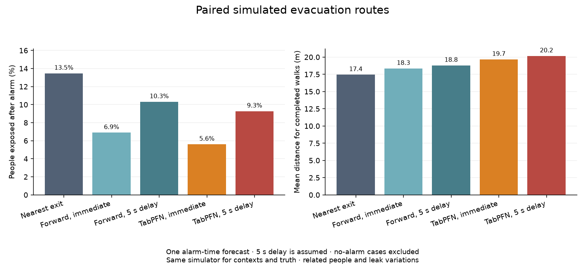

# Hazard forecasts and simulated evacuation routes

This is a paired simulator study of the existing probability-based
`RiskAwarePlanner`. It does not change Steven's planner, the hazard predictor's
probabilities or the detector alarm. A 19% warning overlay is calculated along
each resulting TabPFN route; the overlay is never sent to the planner.

## Design

The study uses the default and random7 factory layouts. On each it generates
20 base leak scenarios using seed 20261203, which is separate from the source
context (12345), hazard context (1001), the spread study (20261129), and the
threshold validation/test splits (20261201/20261202). Each leak is evaluated
under five diffusivities: 0.2, 0.4, 0.8, 1.6 and 3.2 m²/s. Eight sampled
starting positions are paired across the five conditions for that layout/leak.
The 200 condition variations and 1,600 person-variations are correlated, not
200 independent incidents or 1,600 independent people.

Every detected case starts at the first alarm in its noisy sensor history.
Rayan's synchronous locator and rate model receive exactly that history; all
hazard methods share its output. No-alarm cases are counted separately rather
than assigned invented routes. TabPFN uses the fixed-spread context with 100
simulated training leaks, 20 cells per leak and four times (8,000 rows), with
source estimates generated by Rayan's model. Forecasts cover 0-120 s after the
alarm at 10-second intervals, and each factory gets its own context.

For each start position, five policies are replayed against the same simulated
gas:

1. Nearest exit, ignoring the hazard map.
2. Steven's risk planner with forward-simulation hazards, arriving immediately.
3. The same forward forecast arriving after an assumed five seconds.
4. Steven's risk planner with TabPFN probabilities, arriving immediately.
5. The same TabPFN forecast arriving after an assumed five seconds.

In both delayed cases, the person starts towards the nearest exit at the alarm;
if still inside when the forecast arrives, the planner selects a route from the
person's current position. The forecast is a single alarm-time snapshot; it is
not recomputed using new readings. The five-second delay is an illustrative
assumption for the whole response, not a measured call time or a model update
interval. The immediate cases exclude source, hazard and planning latency.

Each one-person replay samples the person's position and the simulated truth
every second from the alarm until exit or 181 seconds after alarm. It records
whether the person encountered toxic or fire-risk cells, time sampled in them,
walking distance and whether the walk finished. Exposure before the alarm is
excluded. These are independent walkers: congestion, queues, route guidance,
injury, and a real factory are not modelled. `RiskAwarePlanner` combines toxic
and fire probabilities under an independence assumption; the current simulated
thresholds make fire a subset of toxicity, so its combined risk remains a
known approximation. Simulator-relative thresholds are not real gas limits.
The summary also separates people who start in a harmful cell at the alarm from
those first exposed after a safe start. This separation does not prove the
route caused an exposure: the simulated gas can move into the person's path.

The overlay uses the previously frozen 0.19 cutoff for fixed-context TabPFN;
0.50 is shown for comparison. Along the TabPFN path, it records each sampled
second as a true or false toxic flag or missed toxic point. These are correlated
route-time samples, not independent false alarms or people. It cannot affect
the path: both overlays are computed from the exact same walk. The study does
not test what would happen if warning labels were used to block or penalise
routes. For any path extending beyond the last forecast, the existing planner
uses the nearest available forecast; those seconds are counted.

The outcome comparison resamples the base-leak index jointly across layouts
and spreading conditions for exploratory paired bootstrap intervals. This
handles some shared variation but cannot quantify performance across new
factories. Context generation and truth both use the same 2D simulator; forward
simulation has the structural advantage of using the same simulator family as
the test. The source locator and hazard model version are not pinned.

## Results

Of 200 case variations, 194 alarmed within 120 s; the six that did not came
from two layout/leak pairs and are excluded below. The 194 cases produced 1,552
paired person-variations, including 67 already in a harmful cell at the alarm.
The remaining 1,485 started in a safe cell. These observations are correlated:
do not interpret them as 1,552 independently sampled workers.

| Route policy | Exposed at any time | Exposed after a safe start | Mean completed distance |
| --- | ---: | ---: | ---: |
| Nearest exit | 209/1,552 (13.47%) | 142/1,485 | 17.45 m |
| Forward, immediate | 107/1,552 (6.89%) | 40/1,485 | 18.35 m |
| Forward, assumed 5 s delay | 160/1,552 (10.31%) | 93/1,485 | 18.79 m |
| TabPFN, immediate | 87/1,552 (5.61%) | 20/1,485 | 19.66 m |
| TabPFN, assumed 5 s delay | 144/1,552 (9.28%) | 77/1,485 | 20.16 m |

All walks finished within the replay, and no route samples exceeded the
forecast horizon. Among safe starts, 9 person-variations were exposed on the
immediate TabPFN route but not the immediate forward route, while 29 were
exposed on forward but not TabPFN. Eleven were exposed on both. For the two
delayed policies, the corresponding counts were four, 20 and 73. These are
matched observations, not evidence that the route alone caused exposure.

The exploratory paired cluster-bootstrap 95% interval for the exposure-rate
difference (immediate TabPFN minus nearest exit) was -11.72 to -4.28 percentage
points. For immediate TabPFN minus immediate forward it was -2.63 to +0.06
points; for the delayed comparison it was -2.57 to +0.13 points. Both forward
comparisons include zero, so these data do not establish that TabPFN is better
than forward simulation. Neither method guarantees a safe route. The assumed
delay illustrates sensitivity, not actual measured deployment latency.



On the exact same immediate TabPFN walks, a 19% toxic overlay flagged 144 of
229 toxic one-second samples and missed 85; it also flagged 149 of 24,011 safe
samples. At 50%, it flagged 71 toxic samples, missed 158 and flagged 27 safe
samples. The 19% overlay catches more toxic samples and raises more false flags,
but still misses some toxic samples. These are correlated time samples, not
independent alarms, and neither overlay affects the routes in this experiment.
Changing the planner to use a cutoff would require a separate evaluation.

## Reproduction

The shape-only cloud quote is free; collection spends credits. Each output and
its metadata sidecar must be new paths. A matching interrupted collection can
be continued with the same arguments and `--resume`.

```bash
uv run python tests/hazard/route_study.py --quote-only --batch 3 \
  --output outputs/route-study.jsonl
uv run python tests/hazard/route_study.py --backend cloud --run-cloud --batch 3 \
  --output outputs/route-study.jsonl
uv run python tests/hazard/summarise_routes.py outputs/route-study.jsonl \
  --figure outputs/route-study.png
```

The figure can also be redrawn from recorded aggregates without cloud calls:

```bash
uv run python tests/hazard/summarise_routes.py --recorded \
  --figure docs/figures/ahmad/06-route-outcomes.png
```

The final completed cloud requests quoted 1,044,389 credits. An earlier pilot's
completed requests quoted at least another 157,024; one interrupted request
may also be billed. These quotes are not a provider billing statement.

An initial cloud pilot was stopped after adding a matching five-second
forward-simulation comparison. Its completed cases were not mixed with the
final run; its interrupted request may still be billed. Results and quotes are
estimates, not provider billing. Per-case route outcomes remain in the ignored
`outputs/` directory.
