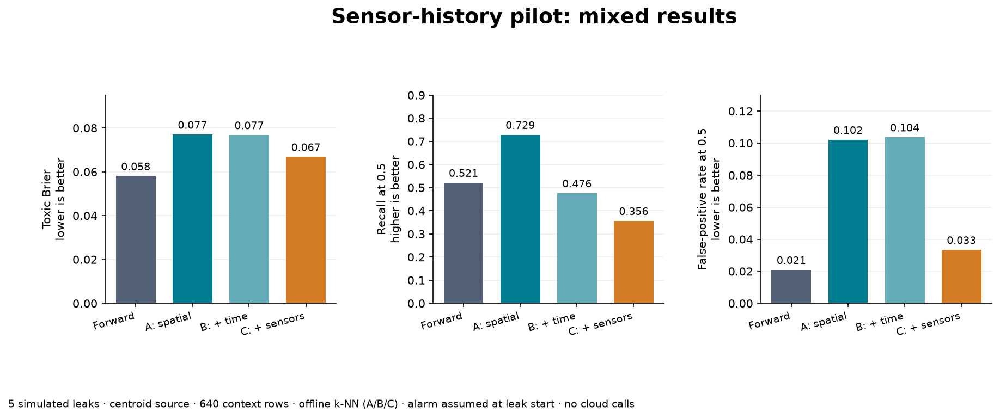

# Sensor-history experiment

Status: **offline pilot only**. The seven-feature predictor remains the default;
the new options are experimental and no cloud ablation has been run.

## Question and implementation

Can gas readings and their recent changes improve a hazard forecast beyond the
existing source estimate, wind and spatial features? Three configurations use
the same predictor, the same source-map mixture and the same forecast targets:

| Version | Configuration | Feature count without geometry |
| --- | --- | ---: |
| A | Existing spatial features | 7 |
| B | `include_time_context=True`: A + observation time and forecast horizon | 9 |
| C | `include_sensor_history=True`: B + sensor summaries | 37 |

`include_sensor_history=True` also turns on time context. `include_geometry=True`
adds the existing two geometry features to any configuration. The public
`HazardPredictor` protocol, the default predictor behavior and the existing source
selection remain unchanged. A direct comparison against the previous revision
confirmed identical default context rows, targets and fake-model hazard maps.

The 28 sensor columns are constructed in `sensor_history.py`:

- For each of the three sensors geometrically nearest to the forecast cell:
  distance, latest available value, rate of change per second, value-available
  flag and trend-available flag (15 columns).
- For the two sensors nearest to the candidate source: the same five values
  (10 columns). The source-specific part is recomputed for each hypothesis.
- Maximum and mean available sensor value, and fraction of available sensors
  (3 columns).

Distances use metres. Latest and previous **finite** samples at or before the
observation time give the trend, using their actual time difference. Missing
readings, a missing trend and padded sensor slots use zeros with availability
flags; thus unknown is distinguishable from a valid reading or trend of zero.
Fewer than five sensors, missing values and one-sample histories are supported.
Global values use only available sensors. Equal distances retain sensor order.
Optional forecasts that precede the latest observation raise an error. The
shared contract requires the caller to pass only currently available readings;
the predictor has no separate decision-time argument to identify future samples.

The simulator experiment deliberately assumes the alarm and leak start coincide
at T=0, as requested. `observation_times` is an optional training-data argument;
the pilot uses it to include T=0 alongside later moments without changing legacy
defaults. This forced initial event is not an actual sensor-triggered alarm: the
simulator begins with zero gas, so the first reading contains only sensor noise.
The resulting startup cases are a simplification, not a detector evaluation.

## Five-scenario offline pilot

Run:

```bash
uv run python tests/hazard/compare_sensor_history.py --episodes 5
```

The script makes no cloud calls by default. It generates **one** set of 640
context rows (20 simulated leaks x 8 sampled cells x 4 forecast times, seed 1001)
and obtains A and B as column subsets of C; all versions therefore use exactly
the same underlying examples and targets. Five held-out pipe-plant leaks use
evaluation seed 0, one shared centroid source estimate per leak, and observation
times 0, 5, 10, 15 and 20 s. Forecasts are evaluated at 0, 10, 20 and 30 s after
each observation on open floor; the corresponding 10,300 cell/time outcomes include
836 toxic observations and are correlated within each leak. The centroid did not
apply the pipe prior or supply a rate; its top-three candidates retained 6.66%
mean source probability. All A/B/C models used the offline k-NN regressor, not
TabPFN; k-NN chunk size was 64. Forward is the existing simulator baseline.

| Metric | Forward | A: spatial | B: + time | C: + sensor history |
| --- | ---: | ---: | ---: | ---: |
| Toxic Brier, lower better | 0.05806 | 0.07700 | 0.07679 | 0.06681 |
| Toxic ECE, lower better | 0.05806 | 0.08188 | 0.07096 | 0.05323 |
| Toxic AUC, higher better | 0.75030 | 0.89279 | 0.83502 | 0.75000 |
| Toxic recall at 0.5, higher better | 0.52153 | 0.72847 | 0.47608 | 0.35646 |
| False-positive rate at 0.5, lower better | 0.02092 | 0.10207 | 0.10366 | 0.03339 |
| Precision at 0.5, higher better | 0.68770 | 0.38667 | 0.28861 | 0.48534 |
| Brier within 6 m of a sensor | 0.05761 | 0.08508 | 0.08198 | 0.06494 |
| Brier farther than 6 m | 0.05889 | 0.06197 | 0.06715 | 0.07030 |
| Hazard-call median seconds | 0.0016 | 0.1086 | 0.0889 | 0.1849 |
| Simulated routes exposed, no latency | 0 / 5 | 0 / 5 | 0 / 5 | 0 / 5 |
| Cloud credits | 0 | 0 | 0 | 0 |

Sensor history reduced Brier versus A on this sample, but its recall and AUC
were lower. It improved Brier near sensors and worsened it farther away relative
to A. The apparent tradeoff is worth investigating, but five leaks cannot prove
any improvement or general ranking. The 0.5 threshold is a preselected test
threshold, not a safety recommendation. Route scores are one-person, immediate
planning replays; they exclude prediction delay and use the shared planner's
provisional toxic/fire combination. For arrival after the 30-second horizon,
the planner uses the nearest available map, i.e. the last forecast. Zero exposed
in every case is inconclusive.
Hazard timings exclude source detection and routing, and do not estimate cloud
latency. The context and evaluation use the same simplified simulator.

The accompanying figure is
.
Recreate it without model calls:

```bash
uv run python tests/hazard/plot_sensor_history.py
```

## Proposed cloud pilot: quoted, not run

For five scenarios and 8,000 context rows (100 leaks x 20 cells x four times),
with three source hypotheses, open-cell-only queries and four forecast times,
the free quote on the current default factory was **10,000 credits per call**
for each of A (7 columns), B (9) and C (37): 15 calls and **150,000 quoted
credits total**. The centroid source uses no cloud calls. This quote covers the
intended prediction calls; it is not a guarantee of billing, setup or future
service pricing. Quote again before execution. The model configuration uses the
cloud backend's default version rather than a pinned version.

```bash
uv run python tests/hazard/compare_sensor_history.py --quote-only --episodes 5 \
  --train-scenarios 100 --cells-per-scenario 20
# Run only after approving the quote:
uv run python tests/hazard/compare_sensor_history.py --backend cloud --run-cloud \
  --episodes 5 --train-scenarios 100 --cells-per-scenario 20
```

The offline 640-row pilot and proposed 8,000-row cloud pilot are different
settings and should not be treated as a paired comparison against each other.
Future work should evaluate Rayan's integrated source and rate estimate, more
leaks and layouts, sensor faults, and end-to-end latency. The combined C variant
does not isolate whether local readings, source-neighborhood readings, global
context or trends caused any difference. Do not change the default on this pilot.
