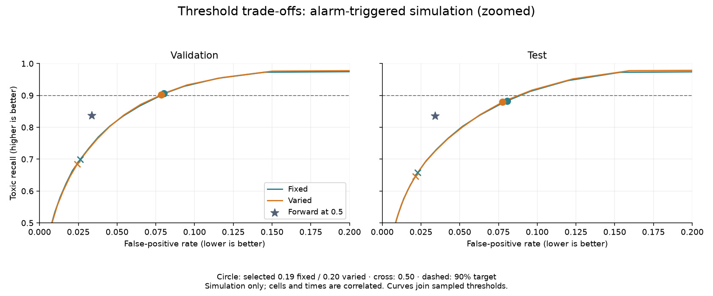

# Experimental toxic-cell warning thresholds

This study explores probability cutoffs for labelling a toxic cell and time in
the existing proof-of-concept simulator. It does **not** change the gas
detector's alarm threshold, the predictor's probabilities, or the evacuation
planner, which uses continuous hazard probabilities. A candidate cutoff is a
research result, not a validated setting for a real plant.

## Design

The agreed target is pooled toxic-cell recall of at least 90% on **validation**
data. For each TabPFN context (fixed and varied diffusivity), the rule chooses
the highest threshold on a 0.00-1.00 grid in steps of 0.01 that meets the
target. The highest eligible threshold also minimises the false-positive rate
within that grid; if only 0 qualifies, every open cell would be flagged. The
thresholds and validation file hash are frozen before running the test split.
The existing 0.50 cutoff and forward-simulation baseline are reported as
comparators. The target is an experimental choice, not a safety requirement.

Two known layouts (default and random7) each get their own source and hazard
contexts. Each split has 20 base leaks per layout, repeated at diffusivities
0.2, 0.4, 0.8, 1.6 and 3.2 m²/s (200 case variations, not independent
leaks). Source context seed 12345; hazard context seed 1001; validation seed
20261201; independent test seed 20261202. Previous study seed 20261129 is not
used in either split. Both models use 100 context leaks, 20 cells per leak,
four forecast times and Rayan's synchronous source and rate estimates.
The varied context samples diffusivity from 0.4-1.6 m²/s.

Each forecast is requested at the first measured sensor alarm, found from the
same fixed noisy history given to the source locator. A leak with no measured
alarm by 120 s has no hazard forecast and is reported separately; all recall
and false-positive metrics are conditional on an alarm. For detected cases,
forecasts are 0, 10, 30, 60 and 120 s after the alarm. Results pool open cells
and times, so cell counts are not independent observations. Bootstrap
intervals resample episode indices jointly across the two layouts and five
conditions; they are conditional on those layouts and the simulator.

Validation chose **0.19 for fixed-context** and **0.20 for varied-context**
TabPFN. These thresholds were frozen in `outputs/threshold-selection-cloud.json`
before test generation. Per-condition and per-horizon recall can be lower than
the pooled target. Source and hazard training use the same simulator as the
truth, and the factory is known when its context is generated. Results do not
validate the physics, guarantee performance in other factories, establish
evacuation safety or establish performance before a sensor alarm. The
synchronous source-rate estimate used here also differs from the first-call
rate prior in the optional `live=True` locator mode.

## Results, 2026-11-22

Recall and false-positive rates pool open cell/time outcomes **only for cases
that alarmed**. The threshold is a probability, so e.g. 0.19 labels a cell at
or above 19% predicted toxic probability as hazardous.

| Split | Method | Cutoff | Toxic recall | False-positive rate |
|---|---|---:|---:|---:|
| Validation | Forward simulation | 0.50 | 83.71% | 3.37% |
| Validation | Fixed context | 0.50 | 69.91% | 2.62% |
| Validation | Fixed context | **0.19** | **90.55%** | **8.02%** |
| Validation | Varied context | 0.50 | 68.51% | 2.44% |
| Validation | Varied context | **0.20** | **90.17%** | **7.85%** |
| Test | Forward simulation | 0.50 | 83.52% | 3.39% |
| Test | Fixed context | 0.50 | 65.76% | 2.29% |
| Test | Fixed context | **0.19** | **88.27%** | **8.05%** |
| Test | Varied context | 0.50 | 64.65% | 2.14% |
| Test | Varied context | **0.20** | **87.93%** | **7.76%** |

Both cutoffs met the 90% pooled target on validation but fell short on this
test. The exploratory episode-cluster bootstrap 95% intervals for test recall
were 83.75-91.72% fixed and 83.55-91.27% varied, conditional on these two
layouts; both include 90%. The intervals are not safety guarantees. On test,
fixed-context recall by diffusivity (0.2, 0.4, 0.8, 1.6, 3.2) was 86.15%,
89.87%, 88.00%, 88.27% and 88.90%; varied was 85.87%, 89.48%, 87.90%,
87.85% and 88.36%. Fixed recall at 0, 10, 30, 60, 120 s after alarm was
89.51%, 90.17%, 87.16%, 88.40%, 87.91%; varied was 89.54%, 90.14%, 86.17%,
88.41%, 87.50%. These subgroup numbers reuse the same cases and are
exploratory.

An alarm occurred by 120 s in 195/200 validation and 179/200 test variations.
All 21 test variations without an alarm were in random7, from five underlying
layout/leak pairs; they are not 21 independent leaks. Their hazardous outcomes do not
appear in the conditional recall table. Under the simulated clean-field alarm
versus noisy-source-reading comparison, the clean alarm occurred before the
noisy source history alarmed in 4/200 validation and 7/200 test variations
(from four and six layout/leak pairs, respectively).
That check illustrates a possible team-integration mismatch; it is not an
observed failure rate of a real alarm system.

The result supports further research on lower cutoffs, but it does not establish
a cutoff that reliably meets 90% across new leaks, layouts, or real data.
No cutoff was selected from the held-out test or applied to the application.



Redraw the plot from recorded *aggregate* counts without cloud calls. The
curve joins selected grid points every 0.05, plus the exact chosen 0.19 and
0.20 values; the reported numbers above use the full 0.01 grid.

```bash
uv run python tests/hazard/summarise_threshold.py --recorded \
  --figure docs/figures/ahmad/05-threshold-tradeoff.png
```

For the separate investigation into the 33 earlier pre-alarm snapshots,
including a clean/noisy alarm mismatch for Steven and Rayan, see
[`DIFFUSIVITY_STUDY.md`](DIFFUSIVITY_STUDY.md).

## Reproduction

Cloud collection spends credits. Each output must be a new path, and the JSONL
metadata sidecar must stay alongside it. The test script verifies that the
frozen validation settings match the test settings. Shape-only cost quotes are
free; actual provider billing can differ.

```bash
uv run python tests/hazard/threshold_study.py --quote-only --output outputs/unused.jsonl
uv run python tests/hazard/threshold_study.py --backend cloud --run-cloud \
  --split validation --output outputs/threshold-validation.jsonl
uv run python tests/hazard/threshold_study.py --backend cloud \
  --select outputs/threshold-validation.jsonl --output outputs/threshold-selection.json
uv run python tests/hazard/threshold_study.py --backend cloud --run-cloud --split test \
  --selection outputs/threshold-selection.json --output outputs/threshold-test.jsonl
uv run python tests/hazard/summarise_threshold.py \
  --selection outputs/threshold-selection.json \
  --validation outputs/threshold-validation.jsonl --test outputs/threshold-test.jsonl \
  --figure outputs/threshold-study.png
```

An interrupted collection can be resumed with the same options, output path,
metadata file, and `--resume`. This run was resumed after a numerical rounding
check and again after an unresponsive service request. The 17 saved cases from
the first interruption were retained; subsequent source batches were rebuilt.
TabPFN provider version and billing are not pinned, and repeated cloud calls can
vary. Raw per-case aggregates live under ignored `outputs/`.
