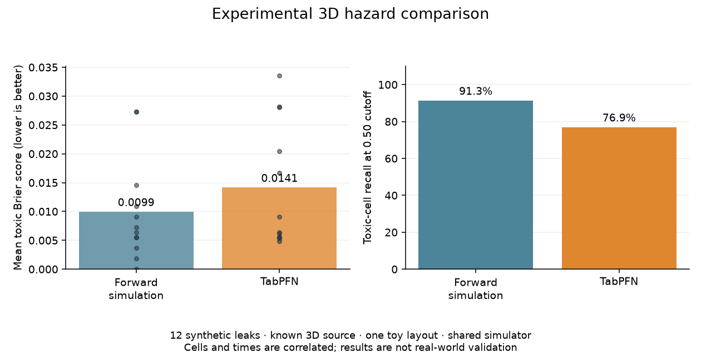

# Experimental 3D hazard prototype

The existing 2D predictor remains available and unchanged. This prototype accepts
explicit 3D source hypotheses and returns separate toxic and fire probability
volumes. A separate experimental adapter now connects Steven's `Plant3D` and
Rayan's location and height estimates for an opt-in smoke check. It is **not wired
into the live pipeline or Steven's planner**. Rayan's height model is in PR #50
and the 3D horizontal locator is in PR #53. No height is invented from a 2D map.

## Shared simulator and source handover

`plant3d_adapter.plant_grid` takes the exact solid-voxel geometry from Steven's
plant, converts it to `(z, y, x)` and marks open voxels within a caller-selected
distance of hot machine boxes. This radius is a modelling assumption.
`plant_training_rows` samples weighted 3D pipe leak sites, wind, rate and mixing,
then takes the training concentrations from Steven's time-stepped 3D simulator.
`TabPFNVolumePredictor.fit_examples` accepts those rows. Fit on each plant before
an emergency; this is still context preparation, not retraining TabPFN weights.

`source_hypotheses` combines the 2D location map with the height quantiles. The
contract supplies separate distributions, so this **assumes horizontal location
and height are independent**; it cannot recover their joint uncertainty. It bins
the quantiles, removes combinations outside the plant or inside solids, reports
the retained mass, then renormalises. The Cartesian combinations are not checked
against the 3D pipe network and may include heights impossible for a given pipe.
`last_retained_mass` additionally records how much of the resulting distribution
the predictor keeps after its top-k selection. Rate is supplied separately; the
smoke check uses Rayan's median rate quantile. Both approximations need further
work before relying on the map for routing.

### First integrated smoke check

One held-out propane leak on the default plant, source `(11, 15, 3.06)` m,
rate 1.0, sensor-noise seed 899. Source/height/hazard contexts each used **eight**
training leaks, seeds 100/111/222 respectively. Hazard context: 3,200 rows,
mixing 0.4–1.6. The alarm fired at 5 s from a mast sensor, and the single
forecast was for 10 s. Location and height were both estimated from readings;
the test did not provide the true leak position to the predictors. Only the
highest-weight 3D source was used, retaining 43.38% of the adapted distribution.

| At toxic cutoff 0.1 and warning probability 0.5 | Forward prototype | Cloud TabPFN |
| --- | ---: | ---: |
| Toxic Brier, lower is better | 0.02070 | 0.00728 |
| Toxic recall | 0.49% (2/412) | 43.69% (180/412) |
| Hazard call time | 0.046 s | 4.90 s |

The forward prototype uses different, simpler transport and relative units than
Steven's simulator, so this is a functionality baseline, not a controlled physics
comparison. The hazard cloud calls quoted 20,000 credits; source and height calls
were additional. The timings exclude fitting and both source calls. One leak and
tiny contexts cannot demonstrate safety or a general accuracy ranking: in this
case TabPFN missed more than half the toxic voxels at the stated warning cutoff,
and its hazard call alone exceeded the team's approximately 2 s route budget.
The 2D experiment's 0.19 cutoff has not been calibrated for this 3D model.

After PRs #50 and #53 are available in the checkout, reproduce the offline or
cloud smoke check with `uv run python tests/hazard/smoke_integrated_3d.py` or
`uv run python tests/hazard/smoke_integrated_3d.py --backend cloud`. The cloud
command spends credits. Neither command performs a route-safety test.

## What goes in and comes out

The caller supplies:

- A 3D grid of wall/obstacle voxels, cell widths, and actual machine bounding
  boxes `(x_min, y_min, z_min)` to `(x_max, y_max, z_max)` in metres. Machines
  are axis-aligned boxes; other shapes need a supplied solid-voxel mask. Each
  box says whether it is an ignition source. For hot machines the caller must
  choose an explicit ignition radius; this is a simplified rule, not a
  validated combustion model.
- Explicit source positions `(x, y, z)` with a weight for each hypothesis, a
  release rate, horizontal wind `(u, v)` and forecast times. No hidden height
  or 2D-to-3D prior is added. These coordinates and weights are a provisional
  research interface, not a claim about Rayan's final contract.
- An explicit 3D mask of allowed source voxels for generating the training
  context. It is separate from the source hypotheses passed during prediction.

`TabPFNVolumePredictor` and the simpler `ForwardVolumePredictor` return a
`HazardVolume`: `p_toxic` and `p_fire` both have shape **(time, z, y, x)**.
`at_height(index)` explicitly extracts one layer as the existing 2D
`HazardMap`; it is a slice, not a safe projection of the whole volume, and the
current planner does not automatically consume the 3D output.

The TabPFN context uses synthetic 3D sources, winds, rates, voxel locations,
times and simulator concentrations. Features include horizontal distance
relative to wind, absolute and relative height, 3D distance and the fraction
of the 3D source-to-voxel line that is unobstructed. For a predicted source
distribution, the model combines the most likely supplied 3D source hypotheses;
`last_retained_mass` records how much weight the chosen hypotheses retained.
The model constructs query features in bounded batches rather than assembling
the full source × time × voxel feature matrix. More batches can still require
more cloud requests, so large volumes must be quoted and timed explicitly.
The source positions used in training are known synthetic truths, not a 3D
source estimator. The model requires prediction geometry to match its training
geometry and does not silently reuse context across different plants.

## Physics and limits

The generator extends the existing simple 2D finite-volume transport with
vertical diffusion. It uses the actual provided 3D solid voxels, so gas can
flow above a low obstacle where the grid has room, while a full-height barrier
blocks it. Floor, ceiling and solids have zero flux; lateral boundaries use
the existing 2D simulator's open-boundary rule. Wind is uniform and horizontal;
there is no wind deflection, vertical wind, HVAC flow, buoyancy, density or
heat-driven flow. The source begins at simulated time zero, following our
current alarm-start assumption.

The simulator's rate and concentration are **relative proof-of-concept units**.
The existing toxic/flammability cutoffs are reused for internal comparisons;
they are not calibrated 3D gas limits. In particular, this model does not
establish safe heights, room ventilation or appropriate protective actions.
The team needs real 3D geometry, pipe/source heights, ignition information and
an agreed source/output contract, plus validated time-dependent gas physics.
This is separate from Steven's steady 3D research study; it does not reproduce
or claim that study's real-data validation.

## First paired synthetic test

Cloud TabPFN compared with the 3D forward-simulation baseline on 12 held-out
synthetic leaks, one 24 × 16 × 4 m layout, two possible source heights,
three forecast times (5/15/30 s), four candidate source voxels, and seed
20261211. The 80 training scenarios (20 sampled cells × three times, 4,800
rows) used seed 20261210. Training and test scenarios are separately drawn,
but use the **same** layout, candidate source positions and simulator family.
The exact simulated 3D source, wind and rate are supplied to both methods;
Rayan's locator and source error are not tested. Diffusivity varies from
0.4–1.6 in training and truth; the forward baseline assumes 0.8. The 0.50
warning cutoff below was fixed in advance for this exploratory comparison;
the earlier 2D 0.19 cutoff has not been calibrated or adopted for this model.

| Metric | Forward simulation | TabPFN |
| --- | ---: | ---: |
| Mean toxic Brier, lower is better | 0.00994 | 0.01414 |
| Pooled toxic recall at 0.50 | 91.34% (633/693) | 76.91% (533/693) |
| Pooled false-positive rate at 0.50 | 0.57% (71/12,483) | 0.87% (108/12,483) |
| Median hazard call time on this machine | 0.011 s | 1.435 s |

TabPFN had a lower Brier in 3/12 cases; forward was better overall on this toy
test. Cells and times within each leak are correlated, the two heights appeared
in 10 and two cases, and the sample is too small to generalise. The baseline
and target share the same numerical simulator family, and both methods have an
oracle source; neither accuracy nor timing represents a live integrated plant.
There is no sensor-to-route latency or route-safety result in this experiment.
The 12 cloud calls quoted 120,000 credits; actual provider billing may differ.
After adding bounded feature construction, a repeat of the first case matched
its original Brier and threshold counts and quoted another 10,000 credits.



## Reproduction

Cloud collection spends credits. Use a fresh output path:

```bash
uv run python tests/hazard/benchmark_volume3d.py --quote-only --output outputs/new-3d.jsonl
uv run python tests/hazard/benchmark_volume3d.py --backend cloud --run-cloud \
  --output outputs/new-3d.jsonl
uv run python tests/hazard/plot_volume3d.py --figure docs/figures/ahmad/08-hazard-3d.png
```

The figure command redraws the recorded original scores without cloud calls;
it does not plot a newly collected run. Case details remain under `outputs/`.
